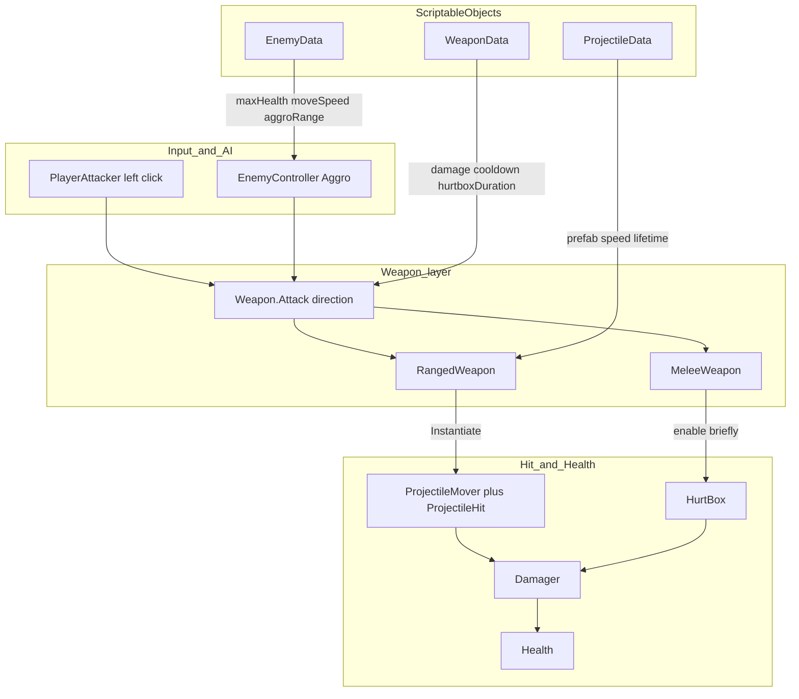
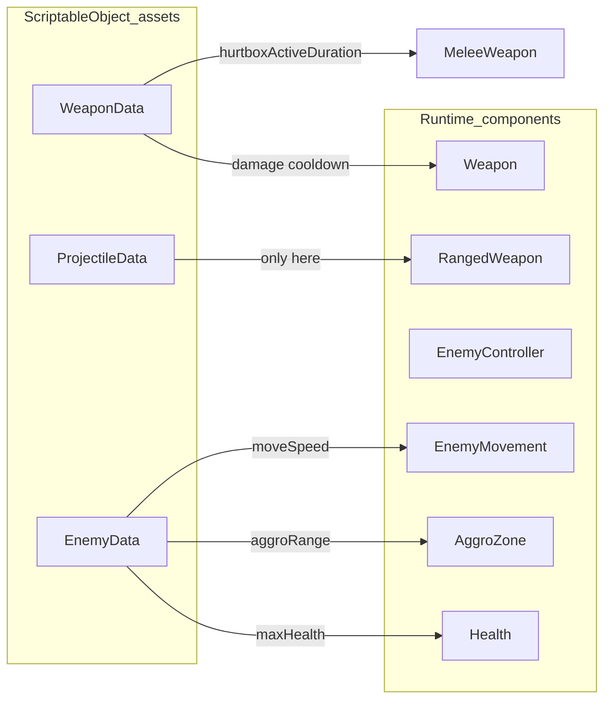
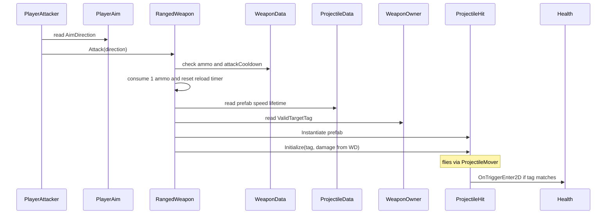
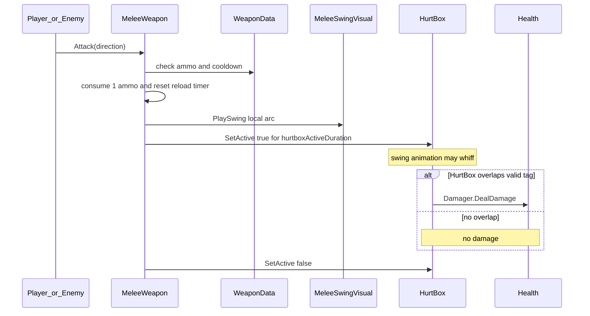
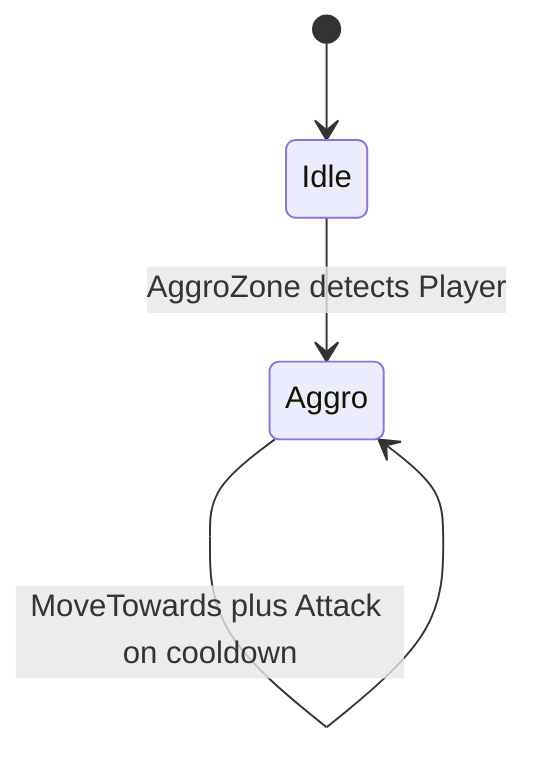
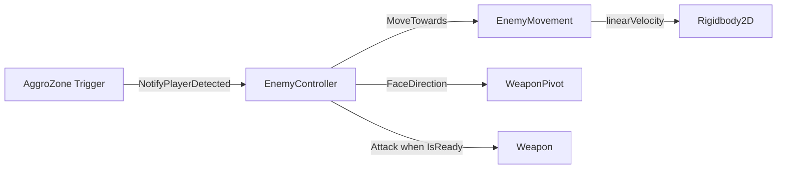
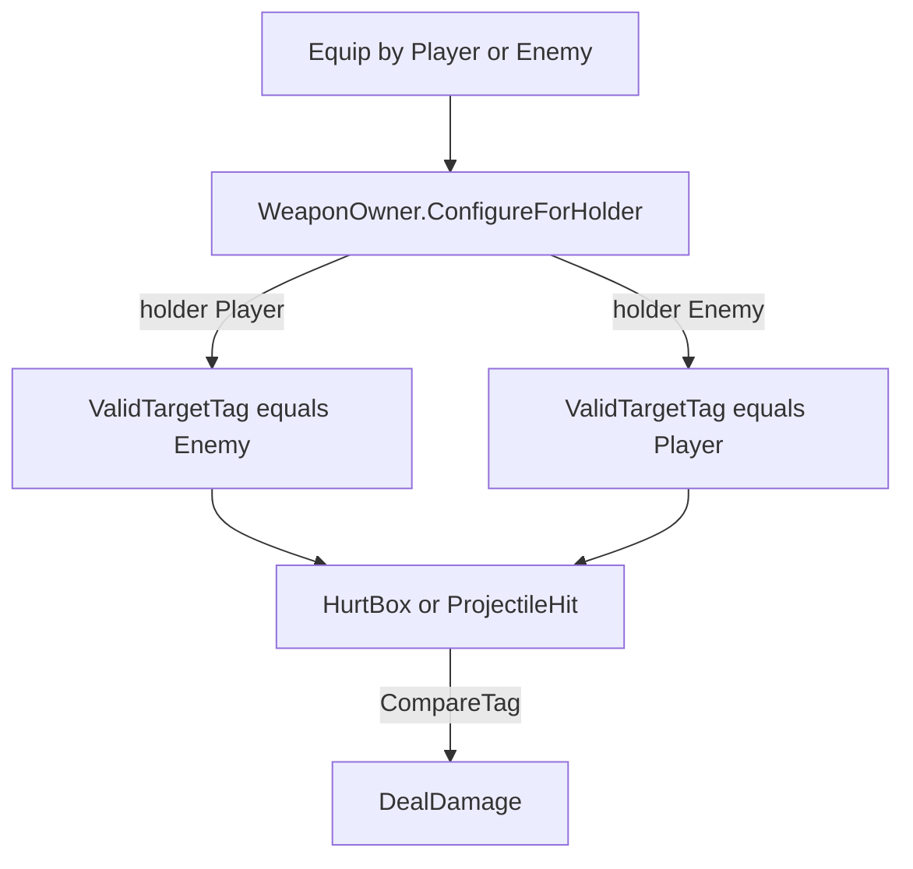
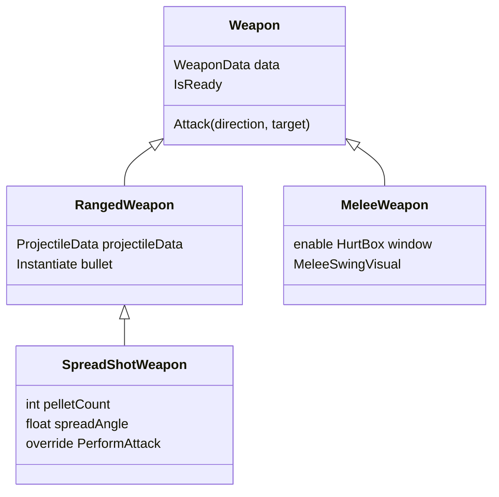
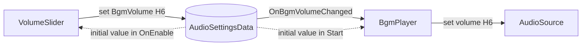

# OOP Lab — Prefab, ScriptableObject, Inheritance

## Goal
Clear the field: find and defeat every enemy. Controls: **WASD** move, **hold Left Mouse** to attack (ammo-limited), **E** swap weapon with one on the ground, **Esc** pause / resume.

## Project layout

```
Assets/
├── Scripts/                  ← Teacher-provided game code (do not rewrite for the lab)
│   ├── Player/
│   ├── Enemy/
│   ├── Combat/               ← Health, Weapon, Projectile, Data class definitions
│   ├── Visuals/
│   ├── Settings/             ← Settings ScriptableObjects (AudioSettingsData)
│   ├── Audio/                ← BgmPlayer
│   ├── UI/                   ← HUD, menus, VolumeSlider
│   └── Optional/             ← Legacy / advanced (not required)
├── EducationalContent/       ← Prefab templates + SO assets to copy / assign
│   ├── Prefabs/
│   └── Data/
├── Docs/
├── Editor/
└── Scenes/
```

## Teacher setup (once)
1. Open Unity and wait for scripts to compile.
2. Menu: **NTHUGDC → Setup Educational Content**
3. This creates `Assets/EducationalContent/` with:
   - `WeaponData_Pistol`, `WeaponData_Axe`, `ProjectileData_Bullet`, `EnemyData_Basic`, `PlayerData_Default`, `AudioSettings_Default`
   - Prefabs: `Player`, `EnemyTemplate`, `WeaponTemplate_Ranged`, `WeaponTemplate_Melee`, `Projectile_Bullet`, `UISegment`, `UIs`, `GameMenus`, `BgmPlayer`
4. Drag `Player` into `BaseScene`. Place a few `EnemyTemplate` instances and a few weapon prefabs on the ground.
5. Replace placeholder sprites with Kenney desert-shooter art on each Prefab’s `Sprite` child.
6. Setup also places `GameMenus` + `EventSystem` + `BgmPlayer` into `BaseScene` (pause / game over Overlay, background music). Or run **NTHUGDC → Setup Game Menus In BaseScene**.
7. To add only the volume settings, run **NTHUGDC → Setup Audio Settings**. Then drag an audio file into the **Bgm Clip** field of `EducationalContent/Prefabs/BgmPlayer` (empty by default). See “Settings with ScriptableObjects (BGM volume)”.

### Generating the student version (`student` branch)

The teacher version (`main`) has `Assets/csc.rsp` (`-define:LAB_SOLUTION`), so it runs the solutions. `Tools/make_student.py` produces the student version: for every `#if LAB_SOLUTION … #else … #endif` it keeps only the `#else` TODO part, and it does not copy `csc.rsp`.

`student` is an **orphan branch** (no shared history with `main`, never merged). Each regeneration adds one commit.

**First time** (create the orphan branch; needs Git 2.42+):

```bash
git worktree add --orphan -b student ../OOPIntro_student
```

> Equivalent on older Git: `git worktree add --detach ../OOPIntro_student`, then run `git switch --orphan student` inside that folder.

**Every time after that** (skip the step above if the worktree already exists):

```bash
python Tools/make_student.py --out ../OOPIntro_student --dry-run   # preview files and holes found
python Tools/make_student.py --out ../OOPIntro_student
cd ../OOPIntro_student
git add -A
git commit -m "Student version v2"
git push -u origin student
```

- `make_student.py` first empties the output folder (keeping `.git`), then copies `Assets/`, `Packages/`, `ProjectSettings/`, `.gitignore` from **the repo the script lives in**. Requires Python 3.10+.
- The last summary line lists the holes it found (should be `LAB-H1` to `LAB-H6`). If any `LAB_SOLUTION` text is left or an `#if` is unmatched, the script reports an error and fails.
- Before pushing, open `../OOPIntro_student` in Unity once: check that it compiles, the game runs, and each hole's feature is really broken.
- If you update exercises mid-course, try to change only files **outside** the holes so students' `git pull` doesn't conflict with their own TODO code.

## Hierarchy rules

### Enemy
```
Enemy
├── UIs             (shared HUD Prefab: Health + Ammo bars)
├── Sprite          (+ VelocityWaddleTween)
├── AggroZone       (CircleCollider2D trigger)
└── WeaponPivot     (+ WeaponPivot; rotates toward player when Aggro)
    └── Weapon      (your chosen weapon prefab instance)
        ├── Sprite
        └── HurtBox
```

### Player
```
Player
├── UIs             (same shared HUD Prefab)
├── Sprite          (+ VelocityWaddleTween)
└── WeaponPivot     (+ WeaponPivot; rotates toward mouse)
    └── Weapon
        ├── Sprite
        └── HurtBox
```

### Weapon
```
Weapon
├── Sprite
└── HurtBox         (melee: enabled only during swing; ranged: leave disabled)
```

`WeaponPivot` owns rotation; the weapon keeps a local `holdOffset` under the pivot.

## Combat system — data flow

This section explains **who calls whom** and **where numbers come from**. You do not need to rewrite these scripts for the lab, but understanding the flow helps you place Prefabs and ScriptableObjects correctly.

### Big picture



**Read it this way:**
1. Something decides to attack (player click, or enemy AI).
2. It calls the same API: `Weapon.Attack(direction, target)`.
3. `Weapon` checks **ammo + fire interval** from `WeaponData`, then calls the subclass.
4. Subclass either spawns a bullet or opens a melee HurtBox.
5. Damage finally reaches `Health` through `Damager` (and a **target tag** filter).

### Who owns which numbers?



| Data | Lives on | Used by |
|------|----------|---------|
| damage, attackCooldown, maxAmmo, reloadTimePerAmmo | `WeaponData` | any `Weapon` |
| hurtboxActiveDuration | `WeaponData` | `MeleeWeapon` only |
| prefab, speed, lifetime | `ProjectileData` | `RangedWeapon` component field (not on WeaponData) |
| maxHealth, moveSpeed, aggroRange | `EnemyData` | `EnemyController` → Health / Movement / AggroZone |
| maxHealth, moveSpeed | `PlayerData` | `PlayerController` → Health / PlayerMover |

Sprites and hierarchy stay on **Prefabs**. SO assets only store **numbers and references**.

### Ranged attack sequence



Same path for enemies: `EnemyController` calls `Attack` toward the player; `WeaponOwner` has already set `ValidTargetTag = "Player"`, so enemy bullets hit the player.

### Melee attack sequence



Important teaching point: **animation ≠ hit**. The swing always plays; damage only happens if the active HurtBox touches a valid target.

### Enemy aggro and chase





- `EnemyData.aggroRange` sets the AggroZone circle radius.
- `EnemyData.moveSpeed` is passed into `EnemyMovement.MoveTowards`.
- Once Aggro, the enemy keeps chasing (no de-aggro in this lab).

### Friendly fire filter (`WeaponOwner`)



When you pick up a weapon with **E**, the same GameObject instance is reparented under the player’s `WeaponPivot` and retagged to hit `"Enemy"`. Dropped weapons become OnGround (non-functioning) until picked up again.

### Inheritance (weapon family)



Shared behavior (ammo, fire interval, equip/drop, owner tag) lives in `Weapon`. Different attack behavior lives in subclasses — that is the OOP inheritance lesson of this lab. `SpreadShotWeapon` goes one level deeper: it overrides `PerformAttack` and calls `base.PerformAttack` several times (exercise H5).

### Ammo and hold-to-fire (Brawl Stars style)

Both melee and ranged use the same magazine on `WeaponData`:

| Field | Meaning |
|-------|---------|
| `maxAmmo` | Magazine size (e.g. 3) |
| `reloadTimePerAmmo` | Seconds to regain **one** ammo while not full |
| `attackCooldown` | Minimum time between two attacks |

Runtime state lives on the `Weapon` instance (not in the SO):

- `CurrentAmmo`, `MaxAmmo`, `ReloadProgress01`, `IsAmmoFull`, `DisplayName` — read by the player HUD
- **Equip starts at 0 ammo**; reload regenerates one-by-one while equipped
- Successful `Attack` spends 1 ammo and **resets** the reload timer
- While equipped and not full, `Update` regenerates ammo one-by-one
- **Hold left mouse** to keep attacking whenever ammo and fire interval allow
- Enemies use the same `IsReady` gate: they burst while they have ammo, keep chasing while reloading, then fire again

### Segmented health / ammo HUD

Shared Prefab `EducationalContent/Prefabs/UIs` (World-space Canvas with `Health` + `Ammo` `SegmentedBar` rows) is nested under **Player** and **EnemyTemplate**:

- Each cell is an instance of `UISegment` (nine-sliced frame + inner `Image` fill)
- Segment count matches `Health.MaxValue` / `Weapon.MaxAmmo` and rebuilds when those change (e.g. weapon swap)
- Full segments use `fillAmount = 1`; empty use `0`
- For ammo, the next empty segment uses `ReloadProgress01` so the fill animates while regenerating
- Scripts: `SegmentView`, `SegmentedBar`, `HealthBarDisplay`, `AmmoBarDisplay` under `Assets/Scripts/UI/`
- `HealthBarDisplay` binds the parent character’s `Health`
- `AmmoBarDisplay` binds the character’s `WeaponPivot.CurrentWeapon` (works for both Player and Enemy)
- `Health.OnChanged` notifies the health bar; the ammo bar polls the equipped weapon each frame

Run **NTHUGDC → Setup Educational Content** if `UIs` / `UISegment` wiring is missing.

### Pause / Game Over

Screen-space Overlay Prefab `EducationalContent/Prefabs/GameMenus` (wired by Setup into `BaseScene`):

- **Esc** toggles pause (`Time.timeScale` 0/1); Pause panel shows/hides immediately
- The Pause panel has a **BGM volume slider** row (+ percentage text) between the title and Restart; `VolumeSlider` writes it into `AudioSettingsData`. `AudioSource` ignores `timeScale`, so music keeps playing and the slider works while paused (see the next section)
- **Win**: all enemies defeated (`EnemyRegistry.OnAllEnemiesDefeated`) → Game Over panel fades in with “You Win!”
- **Lose**: player `Health.OnKilledEvent` → same panel with “You Lose...”
- Game Over fade uses `CanvasGroup` + `Time.unscaledDeltaTime` so it still animates at `timeScale = 0`
- Both panels have a **Restart** button (`SceneManager.LoadScene` current scene)
- Top-left **enemy counter** (`EnemyCountDisplay`): label + remaining + `/` + total (from `EnemyRegistry`)
- `GameManager` debug flags (default off): `skipGameOverPanel`, `skipPauseOnGameOver`
- Needs **EventSystem** + Input System UI module for button clicks
- Clone includes TextMesh Pro Essential Resources under `Assets/TextMesh Pro/` (no extra Import step for HUD/menu text)

## Settings with ScriptableObjects (BGM volume)

`WeaponData` and `EnemyData` store *gameplay numbers*; the same trick works for *game settings*. This project stores the background-music volume in `AudioSettingsData`.

### Why store settings in an SO?

- **One source of truth**: the volume lives in a single asset (`AudioSettings_Default`), not scattered across components. Change the default in one place.
- **Shared by many components**: `VolumeSlider` (writes) and `BgmPlayer` (reads) hold a reference to the **same** asset. They never need to know about each other or search the scene for each other.
- **Observer (event notification)**: `AudioSettingsData.BgmVolume` is a property; its `set` clamps to 0–1 and raises `event Action<float> OnBgmVolumeChanged`. Whoever cares about the volume subscribes; the slider doesn't need to know how many listeners there are.

### Data flow



| Class | File | Key fields |
|-------|------|------------|
| `Settings.AudioSettingsData` | `Scripts/Settings/AudioSettingsData.cs` | `bgmVolume` (0–1, default 0.8); property `BgmVolume`; event `OnBgmVolumeChanged` |
| `Audio.BgmPlayer` | `Scripts/Audio/BgmPlayer.cs` | `Settings`, `Bgm Clip` (drop your audio file here), `Play On Start`; subscribes in OnEnable, loops in Start |
| `UI.VolumeSlider` | `Scripts/UI/VolumeSlider.cs` | `Settings`, `Slider`, `Value Label` (optional, shows “80%”); Slider ← SO in OnEnable |

### Teacher steps

1. Run **NTHUGDC → Setup Audio Settings** (or **NTHUGDC → Setup Educational Content**, which includes it). This creates `EducationalContent/Data/AudioSettings_Default` and `EducationalContent/Prefabs/BgmPlayer`, adds a BGM volume slider to the pause panel, and places `BgmPlayer` in `BaseScene`.
2. Open `EducationalContent/Prefabs/BgmPlayer` and drag an audio file into **Bgm Clip** (empty by default; the scene instance follows the Prefab).
3. Play → hear the music → press **Esc** to pause → drag the **BGM volume** slider. The volume and the percentage update live.

### Student steps

1. In the Project window, right-click **Create → Settings → Audio Settings** to make a second settings asset (e.g. `AudioSettings_Quiet` with volume 0.2).
2. Assign it to the **Settings** field of both the scene `BgmPlayer` and the pause-panel `VolumeSlider`. Play and compare the starting volume of the two assets.
3. Experiment: what happens if you swap **only one** of them (e.g. only the slider)? The slider writes to the new asset while `BgmPlayer` listens to the old one, so dragging does nothing. That is why both must share the same asset.

### Heads-up: SO values persist

- In the **Editor**, changing an SO during Play (dragging the slider or editing in the Inspector) writes **directly to the asset**. Stopping Play does **not** revert it. (Slide: “your changes are saved!!!”) Git will show `AudioSettings_Default.asset` as modified; revert with git if you don't want it.
- A **Build** resets to the packaged values on every launch — an SO is not a save system.

> **Extension**: make the volume survive restarts in a Build. Direction: Unity's `PlayerPrefs` can store a float. Think about when to read it into the SO (e.g. at startup) and when to write it back (e.g. when the volume changes — you already have an event to subscribe to). No code is provided for this one.

## Student assignments

### Getting the student version

The student version lives on the **`student` branch** of the same repo. Key code is removed and replaced with `TODO`s:

```bash
git clone -b student https://github.com/Oaktheplayer/115A_NTHUGDC_OOPIntro.git
```

Or switch to the `student` branch on GitHub and click **Code → Download ZIP**.

- Search the whole project in your IDE for **`TODO [LAB-`** to find every hole; each comment states the goal and gives hints.
- The student version **compiles and runs**; only the matching feature is broken. Play first to see what's wrong, then fill in the code.
- To check answers: `git checkout main` (`main` is the teacher version with solutions; commit your own work before switching). ZIP users can open the same file on the `main` branch on GitHub.

### Exercises H1–H6

| ID | Concept | File / method | Goal in one line |
|----|---------|---------------|------------------|
| H1 | **Physics2D review from last class**: trigger callbacks, Collider2D, tags | `Enemy/AggroZone.cs` — write `OnTriggerEnter2D` yourself | Player enters the circle → notify the enemy |
| H2 | ScriptableObject data | `Enemy/EnemyController.cs` — `Awake` | Apply `EnemyData` to health and aggro range |
| H3 | Spawning Prefabs at runtime | `Combat/Weapon/RangedWeapon.cs` — `PerformAttack` | Spawn a bullet when firing |
| H4 | Composition (owning components) | `Combat/Weapon/HurtBox.cs` — `OnTriggerEnter2D` | Melee hit deals damage |
| H5 | Inheritance, virtual / override | `Combat/Weapon/SpreadShotWeapon.cs` — `PerformAttack` | Shotgun fires a fan of bullets |
| H6 | ScriptableObject settings, Observer | `UI/VolumeSlider.cs`, `Audio/BgmPlayer.cs` | Slider changes the volume |

#### H1 — Enemy detects the player (Physics2D review from last class)
- **File**: `Assets/Scripts/Enemy/AggroZone.cs`. The student version has **no such method** — write the whole thing yourself (name, parameter, body).
- **Goal**: when the player walks into the AggroZone circle, confirm it is the player, then call `controller.NotifyPlayerDetected(other.transform)`.
- **Hints**:
  - The circle's Collider2D has `isTrigger` set, so use the **OnTrigger** family, not OnCollision. If the method name or parameter type (**the 2D version**!) is misspelled, Unity will never call it.
  - The parameter is `Collider2D`, not `Collision2D`; check with `CompareTag(Combat.WeaponOwner.PlayerTag)`.
  - At least one side needs a Rigidbody2D for triggers to fire (enemies already have one).
- **When done**: enemies stay idle until the player enters the circle (the orange Gizmo when an enemy is selected), then chase and shoot.
- **If missing**: enemies never move, turn, or attack — even if you stand right next to them.

#### H2 — Enemy applies EnemyData
- **File**: `Assets/Scripts/Enemy/EnemyController.cs`, `Awake`.
- **Goal**: apply `maxHealth` and `aggroRange` from `data` (`EnemyData`) to `health` and `aggroZone`.
- **Hint**: data lives in one place (`data`) and other components read from it — look for a `public` method on `Health` and on `AggroZone` that accepts these values; remember a component may be `null`.
- **When done**: changing `maxHealth` in `EnemyData` changes the enemy's health-bar segments; changing `aggroRange` changes the detection distance in Play mode.
- **If missing**: every enemy uses the `Health` component's own default (the bar doesn't match `EnemyData`); editing `EnemyData` has no effect on health or aggro range in Play mode. (`moveSpeed` is not part of this hole, so movement still works.)

#### H3 — Fire a bullet
- **File**: `Assets/Scripts/Combat/Weapon/RangedWeapon.cs`, `PerformAttack`.
- **Goal**: spawn a copy of the bullet Prefab at `position` and set its damage and direction.
- **Hints**:
  - `Instantiate(projectileData.prefab, ...)`; then `GetComponent` the `ProjectileHit` / `ProjectileMover` and call their `Initialize(...)`.
  - Damage comes from `data.damage`, the target tag from `owner.ValidTargetTag`; speed and lifetime from `projectileData`.
- **When done**: the player's pistol and ranged enemies fire bullets; bullets damage the other side but not their own side.
- **If missing**: holding left mouse still drains the ammo bar, but **no bullet** appears; ranged enemies can't hurt you either.

#### H4 — Melee HurtBox deals damage
- **File**: `Assets/Scripts/Combat/Weapon/HurtBox.cs`, `OnTriggerEnter2D` (two spots: 1/2 and 2/2).
- **Goal**: (1) find the `Health` component on the object that was hit; (2) hand it to this HurtBox's `Damager` so it deals damage.
- **Hints**:
  - `other.GetComponent<Health>()`; the collider may be on a child, so fall back to `GetComponentInParent<Health>()`.
  - `damager` may be `null` — check it; `Damager` has a method that takes a `Health`.
- **When done**: the axe (or a melee enemy) deals damage on hit; one swing hits each target at most once.
- **If missing**: the swing animation plays and ammo is spent, but **no damage ever happens** — exactly the “animation ≠ hit” lesson.

#### H5 — Shotgun (inherit from RangedWeapon)
- **File**: `Assets/Scripts/Combat/Weapon/SpreadShotWeapon.cs`, `PerformAttack` (`override`).
- **Goal**: rotate `direction` into `pelletCount` evenly spaced directions (total angle `spreadAngle`) and fire once in each.
- **Hints**:
  - Use a `for` loop; `Quaternion.Euler(0f, 0f, angle) * direction` rotates a direction.
  - Call `base.PerformAttack(newDirection, target)` for each pellet so the parent class spawns the bullet — which means **finish H3 first**.
- **Note**: there is no ready-made shotgun Prefab; build one yourself (see item 2 of “Prefab variant exercises” below). One spread shot spends only 1 ammo — that's expected (ammo is spent in the parent `Weapon.Attack`).
- **When done**: pick up the shotgun and fire a fan of `pelletCount` bullets; tweaking `Pellet Count` / `Spread Angle` in the Inspector changes the pattern.
- **If missing**: the student stub calls `base.PerformAttack` once, so the shotgun fires a single bullet like a pistol (or nothing at all if H3 is also missing).

#### H6 — Volume slider (SO settings + Observer)
- **Files**: two spots.
  - `Assets/Scripts/UI/VolumeSlider.cs`, `HandleValueChanged`: when the player drags the slider, write the new value into the SO. Hint: use the **property** `settings.BgmVolume` (not the field) — it notifies every subscriber.
  - `Assets/Scripts/Audio/BgmPlayer.cs`, `HandleVolumeChanged`: when the SO volume changes, make the playing BGM follow. Hint: this method is already subscribed to `settings.OnBgmVolumeChanged` in `OnEnable`; the `volume` parameter is the new value — assign it to `audioSource.volume`.
- **When done**: pause (Esc), drag the slider, and the music volume changes live; after stopping Play, `AudioSettings_Default` in the Inspector keeps the last value you dragged to (see “Heads-up” above).
- **If missing**: the slider moves and the percentage label updates, but the volume never changes.
  - Only VolumeSlider done: the SO value changes (select the asset during Play to see it), but the music uses the new volume only on the **next Play**, because `Start` reads it just once.
  - Only BgmPlayer done: nobody writes to the SO, so the event never fires — still no effect.

### Prefab variant exercises

No code here, but these **depend on the holes above** — if a hole isn't filled, what you build won't work.

#### 1. Enemy Prefab variants (≥2) — finish H1 and H2 first
- Duplicate `EnemyTemplate` under `EducationalContent/Prefabs/`.
- Change the `Sprite` child look.
- Create new **Enemy Data** assets (`Create → Combat → Enemy Data`) and assign different `maxHealth`, `moveSpeed`, `aggroRange`. (Without H2, `maxHealth` / `aggroRange` have no effect.)
- Change which **Weapon** child is attached (melee vs ranged) as part of the enemy design. Ranged enemies need H3 and melee enemies need H4 to hurt you.
- Place them in the scene. Confirm: enemies idle until you enter `AggroZone` (needs H1), then chase via `EnemyMovement` (Rigidbody2D velocity).

#### 2. New Weapon Prefab (≥1) — ranged needs H3, melee needs H4
- Duplicate `WeaponTemplate_Ranged` or `WeaponTemplate_Melee`.
- Create a new **Weapon Data** asset (`Create → Combat → Weapon Data`) — shared stats only (damage, cooldown). Do **not** put sprites in the SO.
- For ranged weapons: also create **Projectile Data** and assign it on the **`RangedWeapon` component** (not on WeaponData). Melee weapons never see this field.
- Assign Weapon Data on the weapon component; tweak `Sprite` / `HurtBox` size on the Prefab.
- Put the weapon in the scene (OnGround). Press **E** near it to swap (same instance becomes non-functioning on the ground).
- **Build the shotgun (H5)**: duplicate `WeaponTemplate_Ranged`, replace the `RangedWeapon` component on the root with `SpreadShotWeapon` (a subclass of `RangedWeapon` with the same fields plus `Pellet Count` / `Spread Angle`), and re-assign Weapon Data and Projectile Data.

#### 3. Optional: more inheritance
- Following H5, subclass `Weapon` / `RangedWeapon` / `MeleeWeapon` for a new attack pattern (e.g. burst fire, piercing), then wrap it in a Prefab students can pick up.

## What ScriptableObjects change
| Asset | Affects |
|-------|---------|
| `WeaponData` | damage, attackCooldown, maxAmmo, reloadTimePerAmmo, hurtbox duration |
| `ProjectileData` | bullet prefab, speed, lifetime — referenced by `RangedWeapon` only |
| `EnemyData` | maxHealth, moveSpeed, aggroRange |
| `PlayerData` | maxHealth, moveSpeed |
| `AudioSettingsData` | bgmVolume (BGM volume; notifies `BgmPlayer` via `OnBgmVolumeChanged` when changed) |

Sprites and hierarchy live on Prefabs. Class definitions live in `Scripts/Combat/Data/` (`AudioSettingsData` in `Scripts/Settings/`); asset instances live in `EducationalContent/Data/`.

## Key scripts (teacher-provided, under `Assets/Scripts/`)
| Script | Role |
|--------|------|
| `Weapon` / `RangedWeapon` / `MeleeWeapon` | OOP inheritance + ammo / fire interval from `WeaponData` |
| `SpreadShotWeapon` | Shotgun subclass of `RangedWeapon` (H5) |
| `WeaponOwner` | Sets target tag (Player→Enemy, Enemy→Player); bullets inherit tag |
| `HurtBox` | Melee hit detection while active |
| `EnemyMovement` | Rigidbody2D velocity only (stun/knockback hooks later) |
| `EnemyController` | Idle / Aggro AI |
| `VelocityWaddleTween` | Walk wiggle from velocity magnitude |
| `MeleeSwingVisual` | Coroutine rotation tween (later student task) |
| `SegmentedBar` / `HealthBarDisplay` / `AmmoBarDisplay` | Segmented world-space health & ammo HUD |
| `EnemyCountDisplay` | Screen-space remaining / total enemy counter |
| `GameManager` | Pause (Esc), win/lose Game Over UI, Restart |
| `PlayerController` | Applies `PlayerData` to Health / PlayerMover |
| `AudioSettingsData` | BGM volume settings SO; raises an event on change |
| `BgmPlayer` | Loops the BGM and subscribes to `AudioSettingsData` volume changes |
| `VolumeSlider` | Pause-panel volume slider; writes to `AudioSettingsData` |
| `Player*` | Ready-to-use player Prefab |

Legacy RangeDetect / old projectile strategies live under `Assets/Scripts/Optional/` and are not required for the lab.

---
中文版：[`LAB_zh-TW.md`](LAB_zh-TW.md)
