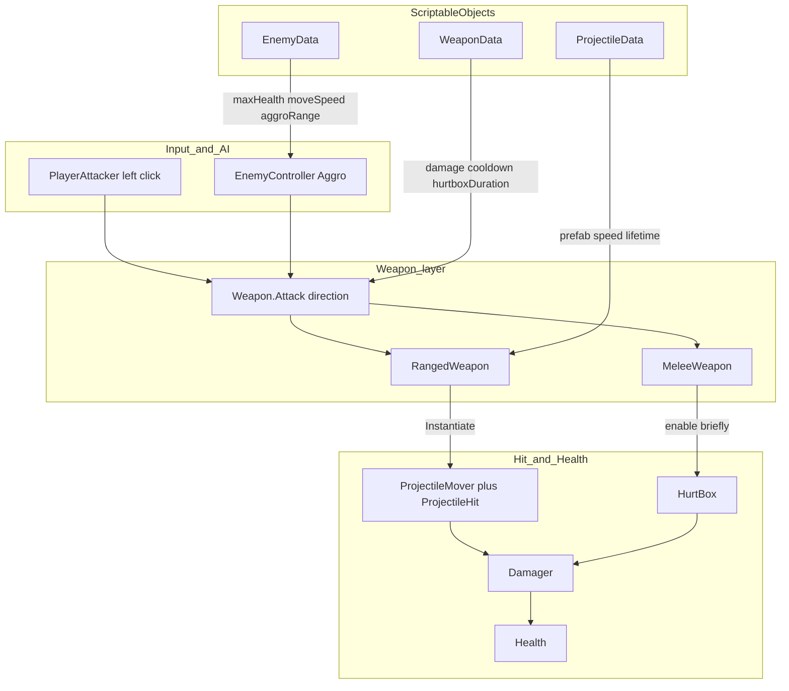
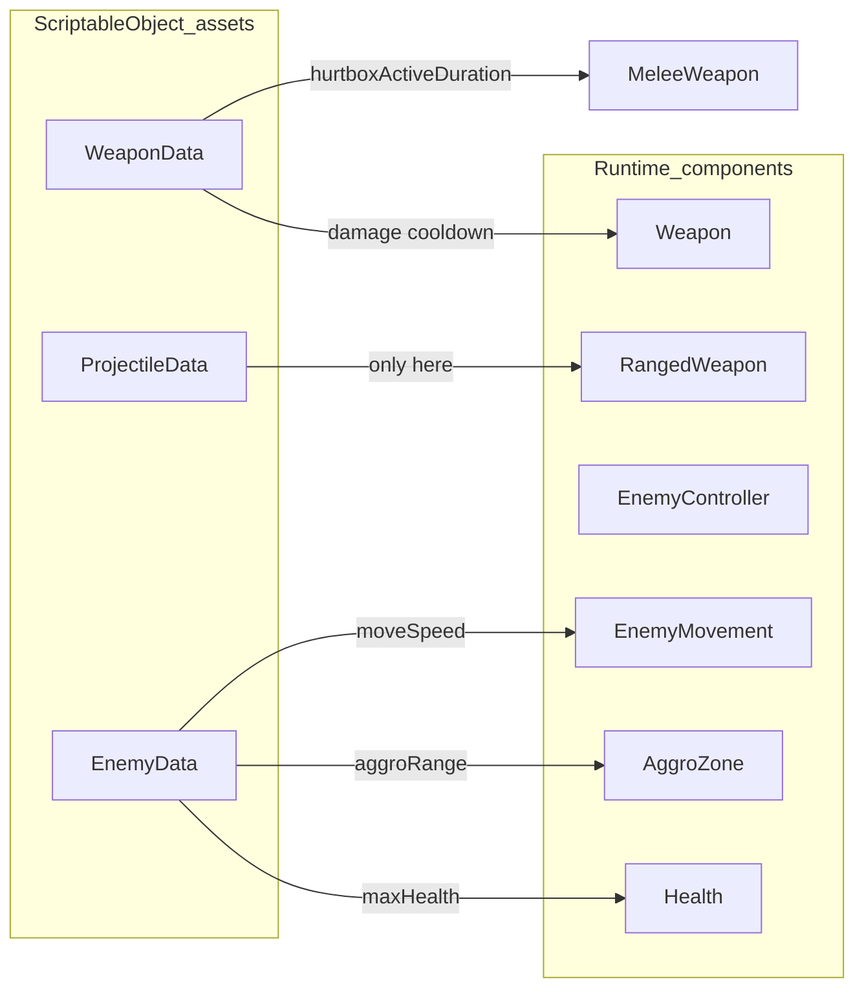
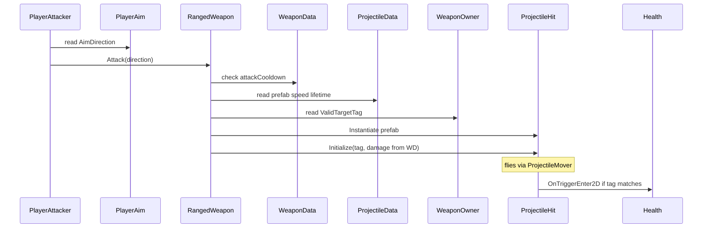
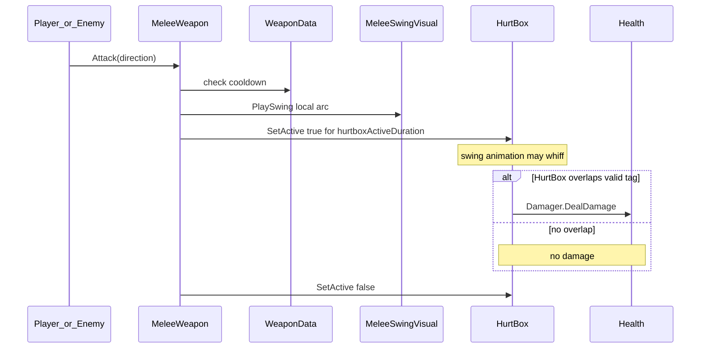
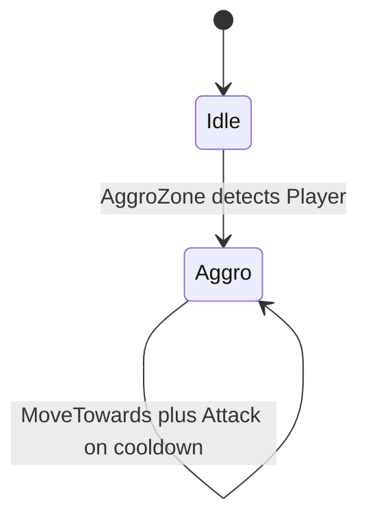
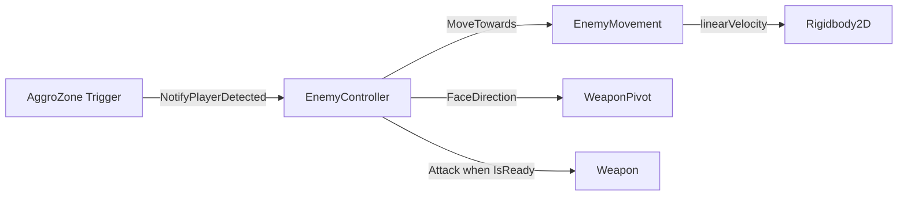
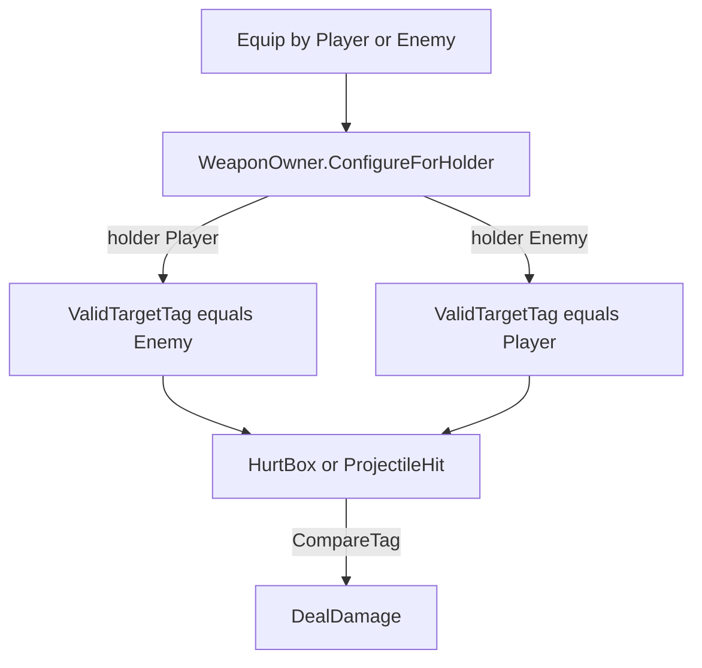
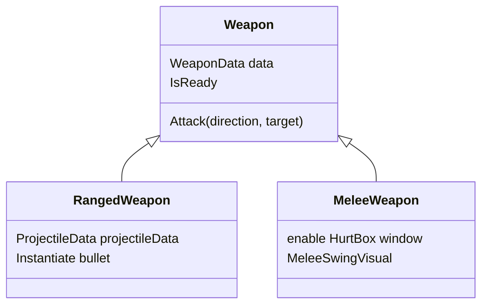

# OOP Lab — Prefab, ScriptableObject, Inheritance

## Goal
Clear the field: find and defeat every enemy. Controls: **WASD** move, **Left Mouse** attack, **E** swap weapon with one on the ground.

## Project layout

```
Assets/
├── Scripts/                  ← Teacher-provided game code (do not rewrite for the lab)
│   ├── Player/
│   ├── Enemy/
│   ├── Combat/               ← Health, Weapon, Projectile, Data class definitions
│   ├── Visuals/
│   └── Optional/             ← Legacy / advanced (not required)
├── EducationalContent/       ← Prefab templates + SO assets to copy / assign
│   ├── Prefabs/
│   └── Data/
├── Docs/
├── Editor/
└── Scenes/
```

## Teacher setup (once)
1. Open Unity and wait for scripts to compile.
2. Menu: **NTHUGDC → Setup Educational Content**
3. This creates `Assets/EducationalContent/` with:
   - `WeaponData_Pistol`, `WeaponData_Axe`, `ProjectileData_Bullet`, `EnemyData_Basic`
   - Prefabs: `Player`, `EnemyTemplate`, `WeaponTemplate_Ranged`, `WeaponTemplate_Melee`, `Projectile_Bullet`
4. Drag `Player` into `BaseScene`. Place a few `EnemyTemplate` instances and a few weapon prefabs on the ground.
5. Replace placeholder sprites with Kenney desert-shooter art on each Prefab’s `Sprite` child.

## Hierarchy rules

### Enemy
```
Enemy
├── Sprite          (+ VelocityWaddleTween)
├── AggroZone       (CircleCollider2D trigger)
└── WeaponPivot     (+ WeaponPivot; rotates toward player when Aggro)
    └── Weapon      (your chosen weapon prefab instance)
        ├── Sprite
        └── HurtBox
```

### Player
```
Player
├── Sprite          (+ VelocityWaddleTween)
└── WeaponPivot     (+ WeaponPivot; rotates toward mouse)
    └── Weapon
        ├── Sprite
        └── HurtBox
```

### Weapon
```
Weapon
├── Sprite
└── HurtBox         (melee: enabled only during swing; ranged: leave disabled)
```

`WeaponPivot` owns rotation; the weapon keeps a local `holdOffset` under the pivot.

## Combat system — data flow

This section explains **who calls whom** and **where numbers come from**. You do not need to rewrite these scripts for the lab, but understanding the flow helps you place Prefabs and ScriptableObjects correctly.

### Big picture



**Read it this way:**
1. Something decides to attack (player click, or enemy AI).
2. It calls the same API: `Weapon.Attack(direction, target)`.
3. `Weapon` checks **cooldown** from `WeaponData`, then calls the subclass.
4. Subclass either spawns a bullet or opens a melee HurtBox.
5. Damage finally reaches `Health` through `Damager` (and a **target tag** filter).

### Who owns which numbers?



| Data | Lives on | Used by |
|------|----------|---------|
| damage, attackCooldown | `WeaponData` | any `Weapon` |
| hurtboxActiveDuration | `WeaponData` | `MeleeWeapon` only |
| prefab, speed, lifetime | `ProjectileData` | `RangedWeapon` component field (not on WeaponData) |
| maxHealth, moveSpeed, aggroRange | `EnemyData` | `EnemyController` → Health / Movement / AggroZone |

Sprites and hierarchy stay on **Prefabs**. SO assets only store **numbers and references**.

### Ranged attack sequence



Same path for enemies: `EnemyController` calls `Attack` toward the player; `WeaponOwner` has already set `ValidTargetTag = "Player"`, so enemy bullets hit the player.

### Melee attack sequence



Important teaching point: **animation ≠ hit**. The swing always plays; damage only happens if the active HurtBox touches a valid target.

### Enemy aggro and chase





- `EnemyData.aggroRange` sets the AggroZone circle radius.
- `EnemyData.moveSpeed` is passed into `EnemyMovement.MoveTowards`.
- Once Aggro, the enemy keeps chasing (no de-aggro in this lab).

### Friendly fire filter (`WeaponOwner`)



When you pick up a weapon with **E**, the same GameObject instance is reparented under the player’s `WeaponPivot` and retagged to hit `"Enemy"`. Dropped weapons become OnGround (non-functioning) until picked up again.

### Inheritance (weapon family)



Shared behavior (cooldown, equip/drop, owner tag) lives in `Weapon`. Different attack behavior lives in subclasses — that is the OOP inheritance lesson of this lab.

## Student assignments

### 1. Enemy Prefab variants (≥2)
- Duplicate `EnemyTemplate` under `EducationalContent/Prefabs/`.
- Change the `Sprite` child look.
- Create new **Enemy Data** assets (`Create → Combat → Enemy Data`) and assign different `maxHealth`, `moveSpeed`, `aggroRange`.
- Change which **Weapon** child is attached (melee vs ranged) as part of the enemy design.
- Place them in the scene. Confirm: enemies idle until you enter `AggroZone`, then chase via `EnemyMovement` (Rigidbody2D velocity).

### 2. New Weapon Prefab (≥1)
- Duplicate `WeaponTemplate_Ranged` or `WeaponTemplate_Melee`.
- Create a new **Weapon Data** asset (`Create → Combat → Weapon Data`) — shared stats only (damage, cooldown). Do **not** put sprites in the SO.
- For ranged weapons: also create **Projectile Data** and assign it on the **`RangedWeapon` component** (not on WeaponData). Melee weapons never see this field.
- Assign Weapon Data on the weapon component; tweak `Sprite` / `HurtBox` size on the Prefab.
- Put the weapon in the scene (OnGround). Press **E** near it to swap (same instance becomes non-functioning on the ground).

### 3. Optional inheritance
- Subclass `Weapon` / `RangedWeapon` / `MeleeWeapon` for a new firing pattern, then wrap it in a Prefab students can pick up.

## What ScriptableObjects change
| Asset | Affects |
|-------|---------|
| `WeaponData` | damage, attackCooldown, hurtbox duration (shared by melee & ranged) |
| `ProjectileData` | bullet prefab, speed, lifetime — referenced by `RangedWeapon` only |
| `EnemyData` | maxHealth, moveSpeed, aggroRange |

Sprites and hierarchy live on Prefabs. Class definitions live in `Scripts/Combat/Data/`; asset instances live in `EducationalContent/Data/`.

## Key scripts (teacher-provided, under `Assets/Scripts/`)
| Script | Role |
|--------|------|
| `Weapon` / `RangedWeapon` / `MeleeWeapon` | OOP inheritance + cooldown from `WeaponData` |
| `WeaponOwner` | Sets target tag (Player→Enemy, Enemy→Player); bullets inherit tag |
| `HurtBox` | Melee hit detection while active |
| `EnemyMovement` | Rigidbody2D velocity only (stun/knockback hooks later) |
| `EnemyController` | Idle / Aggro AI |
| `VelocityWaddleTween` | Walk wiggle from velocity magnitude |
| `MeleeSwingVisual` | Coroutine rotation tween (later student task) |
| `Player*` | Ready-to-use player Prefab |

Legacy RangeDetect / old projectile strategies live under `Assets/Scripts/Optional/` and are not required for the lab.

---
中文版：[`Assets/Docs/LAB_zh-TW.md`](Assets/Docs/LAB_zh-TW.md)
