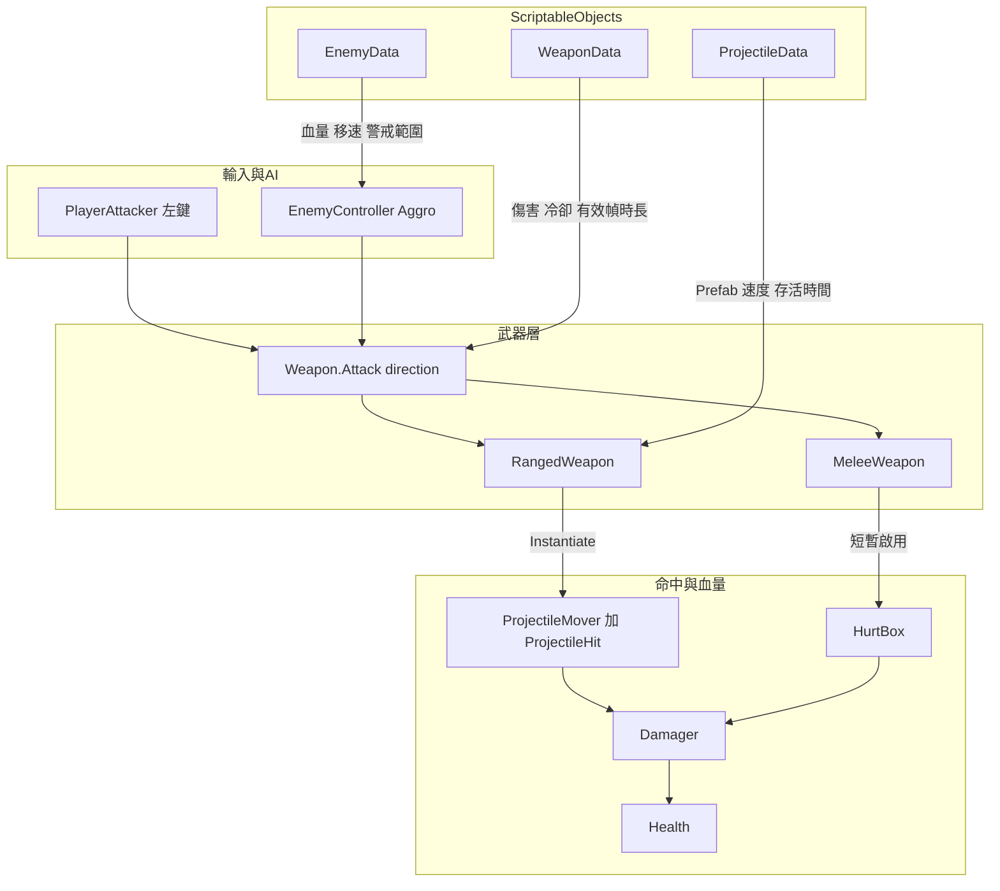
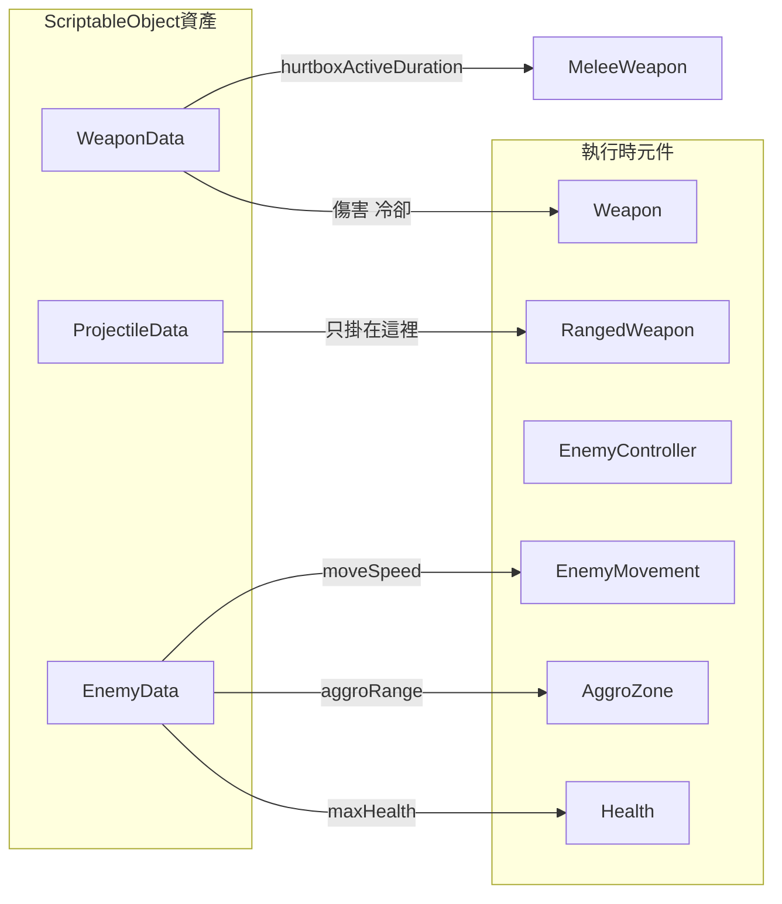
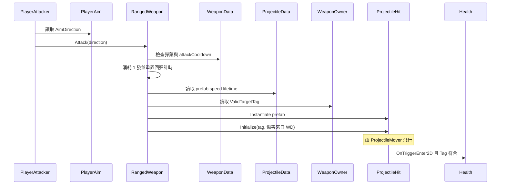
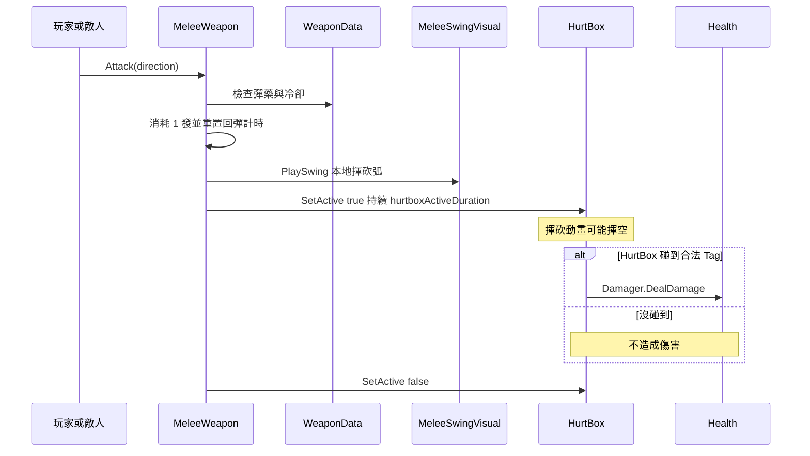
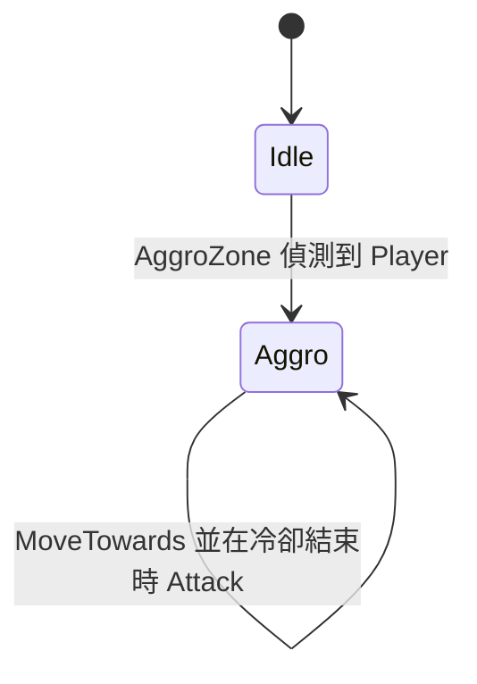
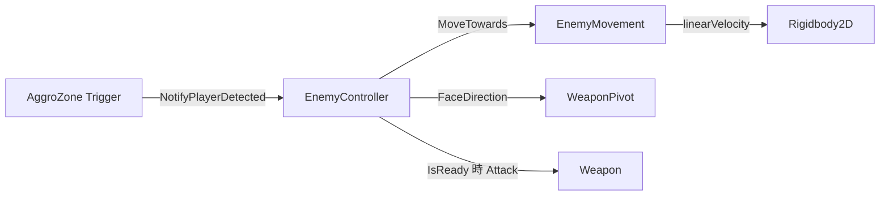
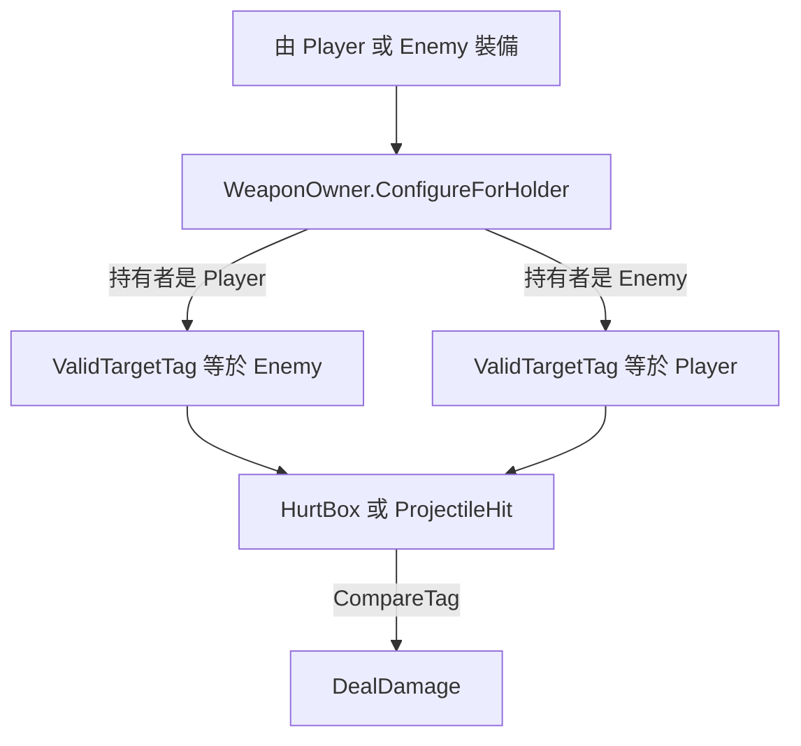
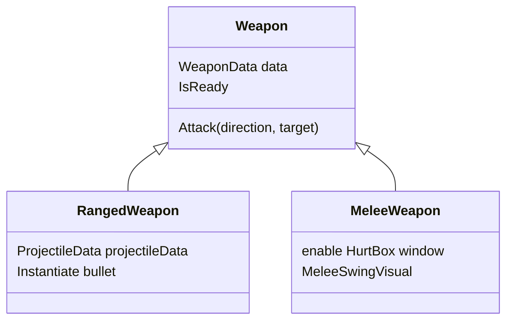

# OOP Lab — Prefab、ScriptableObject 與繼承

## 目標
清場：找到並擊敗場上所有敵人。操作：**WASD** 移動、**按住左鍵**攻擊（受彈藥限制）、**E** 與地上的武器交換、**Space** 暫停／繼續。

## 專案資料夾結構

```
Assets/
├── Scripts/                  ← 教師提供的遊戲程式碼（本課不需重寫）
│   ├── Player/
│   ├── Enemy/
│   ├── Combat/               ← Health、Weapon、Projectile、Data 類別定義
│   ├── Visuals/
│   └── Optional/            ← 舊版／進階選修（本實驗不需要）
├── EducationalContent/      ← Prefab 範本與 SO 資產（複製／指派用）
│   ├── Prefabs/
│   └── Data/
├── Docs/
├── Editor/
└── Scenes/
```

## 教師準備（一次）
1. 開 Unity 並等腳本編譯完成。
2. 進入選單：**NTHUGDC → Setup Educational Content**
3. 這會建立 `Assets/EducationalContent/`，包含：
   - `WeaponData_Pistol`、`WeaponData_Axe`、`ProjectileData_Bullet`、`EnemyData_Basic`、`PlayerData_Default`
   - Prefab：`Player`、`EnemyTemplate`、`WeaponTemplate_Ranged`、`WeaponTemplate_Melee`、`Projectile_Bullet`、`UISegment`、`UIs`、`GameMenus`
4. 將 `Player` 拖到 `BaseScene`。放入幾個 `EnemyTemplate` 與數把地上武器（OnGround）。
5. 把各 Prefab 的 `Sprite` 子物件換成 Kenney 的沙漠射擊素材。
6. Setup 也會把 `GameMenus` + `EventSystem` 放進 `BaseScene`（暫停／結算 Overlay）。或單獨執行 **NTHUGDC → Setup Game Menus In BaseScene**。

## Prefab 階層規範

### Enemy
```
Enemy
├── UIs             （共用 HUD Prefab：血條 + 彈藥條）
├── Sprite          (+ VelocityWaddleTween)
├── AggroZone       (CircleCollider2D 觸發器)
└── WeaponPivot     (+ WeaponPivot；Aggro 後朝向玩家)
    └── Weapon      (你選的武器 Prefab 實例)
        ├── Sprite
        └── HurtBox
```

### Player
```
Player
├── UIs             （同一個共用 HUD Prefab）
├── Sprite          (+ VelocityWaddleTween)
└── WeaponPivot     (+ WeaponPivot；朝向滑鼠)
    └── Weapon
        ├── Sprite
        └── HurtBox
```

### Weapon
```
Weapon
├── Sprite
└── HurtBox         (近戰：僅在揮砍有效期間開啟；遠程：保持關閉)
```

`WeaponPivot` 負責旋轉；武器在 pivot 底下使用本地 `holdOffset`（偏移量）。

## 戰鬥系統 — 資料流

本節說明**誰呼叫誰**、以及**數值從哪裡來**。本實驗不需要重寫這些腳本，但理解資料流有助於正確放置 Prefab 與 ScriptableObject。

### 整體流程



**怎麼讀這張圖：**
1. 某一方決定攻擊（玩家按左鍵，或敵人 AI）。
2. 都呼叫同一個 API：`Weapon.Attack(direction, target)`。
3. `Weapon` 用 `WeaponData` 檢查**彈藥 + 攻擊間隔**，再呼叫子類別。
4. 子類別要嘛生成子彈，要嘛打開近戰 HurtBox。
5. 傷害最後經 `Damager`（加上**目標 Tag** 過濾）進到 `Health`。

### 數值由誰持有？



| 資料 | 放在哪 | 誰使用 |
|------|--------|--------|
| damage、attackCooldown、maxAmmo、reloadTimePerAmmo | `WeaponData` | 任何 `Weapon` |
| hurtboxActiveDuration | `WeaponData` | 僅 `MeleeWeapon` |
| prefab、speed、lifetime | `ProjectileData` | `RangedWeapon` 元件欄位（不在 WeaponData 上） |
| maxHealth、moveSpeed、aggroRange | `EnemyData` | `EnemyController` → Health／Movement／AggroZone |
| maxHealth、moveSpeed | `PlayerData` | `PlayerController` → Health／PlayerMover |

Sprite 與階層留在 **Prefab**。SO 資產只存**數字與引用**。

### 遠程攻擊時序



敵人走同一條路：`EnemyController` 朝玩家呼叫 `Attack`；`WeaponOwner` 已把 `ValidTargetTag` 設成 `"Player"`，所以敵方子彈會打中玩家。

### 近戰攻擊時序



重要教學點：**動畫 ≠ 命中**。揮砍一定會播；只有啟用中的 HurtBox 碰到合法目標才扣血。

### 敵人警戒與追擊





- `EnemyData.aggroRange` 決定 AggroZone 圓形半徑。
- `EnemyData.moveSpeed` 傳入 `EnemyMovement.MoveTowards`。
- 進入 Aggro 後會持續追擊（本實驗不做 de-aggro）。

### 敵我過濾（`WeaponOwner`）



按 **E** 拾取時，同一個武器 GameObject 會改掛到玩家的 `WeaponPivot` 下，並改成打 `"Enemy"`。丟下後變成 OnGround（不可攻擊），直到再次被撿起。

### 繼承（武器家族）



共用行為（彈藥、攻擊間隔、裝備／丟下、敵我 Tag）在 `Weapon`；不同攻擊方式在子類別——這就是本實驗的 OOP 繼承重點。

### 彈藥與按住連發（Brawl Stars 風格）

近戰與遠程都使用 `WeaponData` 上的同一套彈匣：

| 欄位 | 意義 |
|------|------|
| `maxAmmo` | 彈匣容量（例如 3） |
| `reloadTimePerAmmo` | 未滿時回 **1 發** 所需秒數 |
| `attackCooldown` | 兩次攻擊之間的最短間隔 |

執行時狀態在 `Weapon` 實例上（不寫進 SO）：

- `CurrentAmmo`、`MaxAmmo`、`ReloadProgress01`、`IsAmmoFull`、`DisplayName` — 由玩家 HUD 讀取
- **裝備時從 0 發開始**；之後在裝備中一發一發回彈
- 成功的 `Attack` 消耗 1 發，並**重置**回彈計時
- 裝備中且未滿彈時，`Update` 會一發一發回彈
- **按住左鍵**即可在有彈且間隔允許時連續攻擊
- 敵人也走同一個 `IsReady`：有彈就連打，空彈時繼續追擊並回彈，回出子彈再開火

### 分段血條／彈藥 HUD

共用 Prefab `EducationalContent/Prefabs/UIs`（World-space Canvas，含 `Health` + `Ammo` 兩列 `SegmentedBar`）會掛在 **Player** 與 **EnemyTemplate** 底下：

- 每一格是 `UISegment` 實例（九宮格外框 + 內部 `Image` fill）
- 段數對齊 `Health.MaxValue`／`Weapon.MaxAmmo`，數值改變時會重建（例如換槍）
- 滿格 `fillAmount = 1`，空格為 `0`
- 彈藥的下一空格使用 `ReloadProgress01`，回彈過程會看到 fill 動畫
- 腳本：`Assets/Scripts/UI/` 下的 `SegmentView`、`SegmentedBar`、`HealthBarDisplay`、`AmmoBarDisplay`
- `HealthBarDisplay` 綁定角色身上的 `Health`
- `AmmoBarDisplay` 綁定角色的 `WeaponPivot.CurrentWeapon`（玩家與敵人都適用）
- `Health.OnChanged` 通知血條；彈藥條每幀輪詢當前武器

若缺少 `UIs`／`UISegment` 配線，執行 **NTHUGDC → Setup Educational Content**。

### 暫停／結算 UI

Screen-space Overlay Prefab `EducationalContent/Prefabs/GameMenus`（Setup 會接到 `BaseScene`）：

- **Space** 切換暫停（`Time.timeScale` 0/1）；Pause 面板即顯即隱
- **勝利**：清光敵人（`EnemyRegistry.OnAllEnemiesDefeated`）→ Game Over 淡入「You Win!」
- **失敗**：玩家 `Health.OnKilledEvent` → 同面板「You Lose...」
- 結算淡入用 `CanvasGroup` + `Time.unscaledDeltaTime`，在 `timeScale = 0` 時仍能播
- 兩邊都有 **Restart** 按鈕（`SceneManager.LoadScene` 重載目前場景）
- 左上角 **敵人計數**（`EnemyCountDisplay`）：標籤 + 剩餘 + `/` + 總數（來自 `EnemyRegistry`）
- `GameManager` 除錯旗標（預設關閉）：`skipGameOverPanel`、`skipPauseOnGameOver`
- 需要 **EventSystem** + Input System UI module 才能點按鈕
- Clone 後已含 TextMesh Pro Essential Resources（`Assets/TextMesh Pro/`），選單文字不必再 Import

## 學生任務

### 1. Enemy Prefab 變體（至少 2 種）
- 在 `EducationalContent/Prefabs/` 裡複製 `EnemyTemplate`。
- 更換 `Sprite` 子物件外觀。
- 建立新的 **Enemy Data** 資產（`Create → Combat → Enemy Data`），並指派不同：
  `maxHealth`、`moveSpeed`、`aggroRange`。
- 把敵人身上的 **Weapon** 子物件換成不同類型（近戰／遠程）——這是敵人設計的一部分。
- 放進場景中測試：敵人未靠近前不動；進入 `AggroZone` 後才會追擊（透過 `EnemyMovement`，使用 Rigidbody2D velocity）。

### 2. 新的 Weapon Prefab（至少 1 把）
- 複製 `WeaponTemplate_Ranged` 或 `WeaponTemplate_Melee`。
- 建立新的 **Weapon Data** 資產（`Create → Combat → Weapon Data`）：
  僅填寫共享數值（damage、cooldown）。SO 裡不要放 Sprite。
- 遠程武器：另外建立 **Projectile Data**，並指派到 **`RangedWeapon` 元件**（不要放在 WeaponData 裡）。
  近戰武器不會用到這個欄位。
- 在武器 Prefab 上調整 `Sprite` / `HurtBox` 尺寸。
- 把武器放到場景（OnGround）。靠近按 **E** 進行拾取／交換（同一實例會變成非功能性的地上狀態）。

### 3. （選修）繼承練習
- 繼承 `Weapon` / `RangedWeapon` / `MeleeWeapon` 做出新的攻擊行為，然後把它做成可拾取的 Weapon Prefab。

## ScriptableObjects 會改變什麼
| 資產 | 影響 |
|------|------|
| `WeaponData` | damage、attackCooldown、maxAmmo、reloadTimePerAmmo、近戰 hurtbox 時長 |
| `ProjectileData` | bullet prefab、speed、lifetime（僅由 `RangedWeapon` 參考） |
| `EnemyData` | maxHealth、moveSpeed、aggroRange |
| `PlayerData` | maxHealth、moveSpeed |

Sprite 與階層結構放在 Prefab；類別定義在 `Scripts/Combat/Data/`，資產實例放在 `EducationalContent/Data/`。

## 主要教師提供的程式（在 `Assets/Scripts/`）
| Script | 角色 |
|--------|------|
| `Weapon` / `RangedWeapon` / `MeleeWeapon` | OOP 繼承 + 從 `WeaponData` 讀彈藥／攻擊間隔 |
| `WeaponOwner` | 設定要打的目標標籤（Player→Enemy、Enemy→Player）；子彈會繼承設定 |
| `HurtBox` | 近戰在有效幀偵測命中並造成傷害 |
| `EnemyMovement` | 只做 Rigidbody2D velocity 移動（stun／knockback 之後再擴充） |
| `EnemyController` | Idle／Aggro 行為 |
| `VelocityWaddleTween` | 依速度大小做行走小擺動 |
| `MeleeSwingVisual` | 揮砍視覺的旋轉 tween（之後學生再做） |
| `SegmentedBar` / `HealthBarDisplay` / `AmmoBarDisplay` | 分段 World-space 血條與彈藥 HUD |
| `EnemyCountDisplay` | Screen-space 敵人剩餘／總數計數 |
| `GameManager` | 暫停（Space）、勝負結算 UI、Restart |
| `PlayerController` | 將 `PlayerData` 套用到 Health／PlayerMover |
| `Player*` | 已完成的玩家 Prefab |

舊版 RangeDetect／舊彈道策略在 `Assets/Scripts/Optional/`，本實驗不需要。

---
English version: [`LAB.md`](LAB.md)

