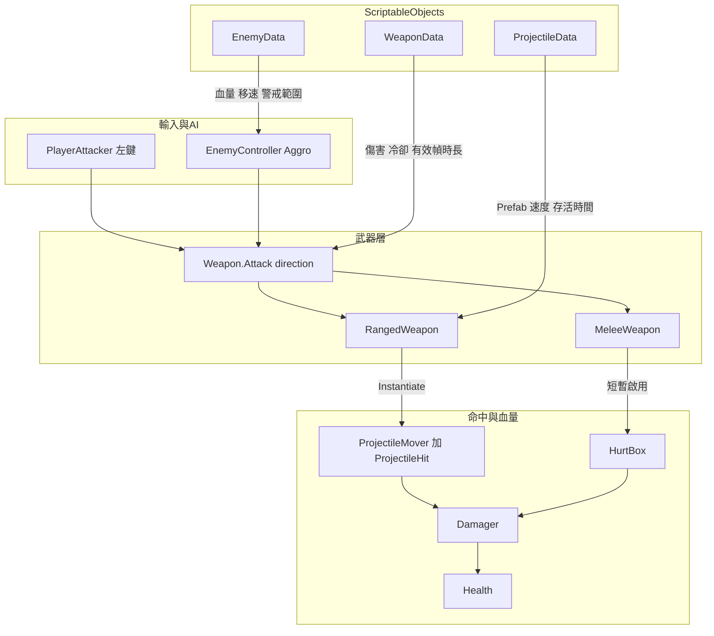
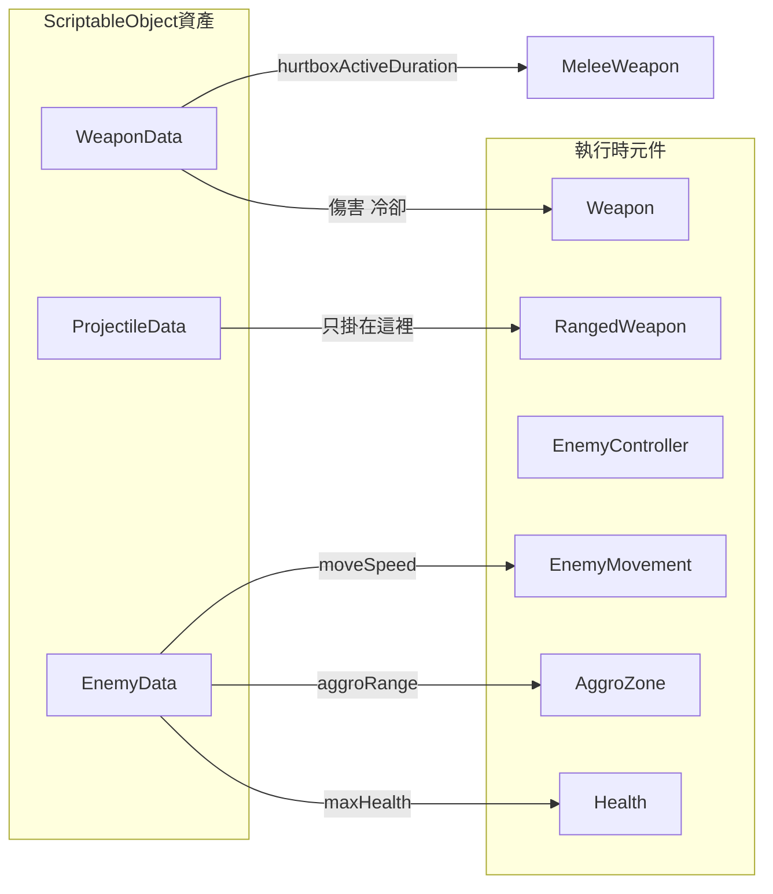
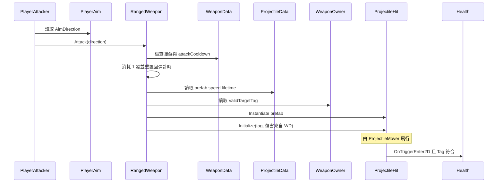
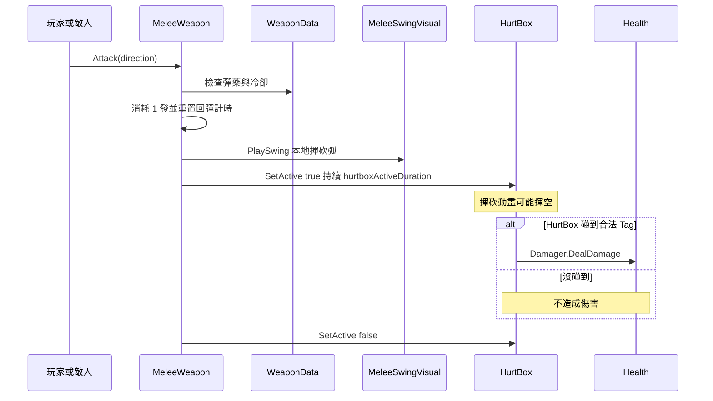
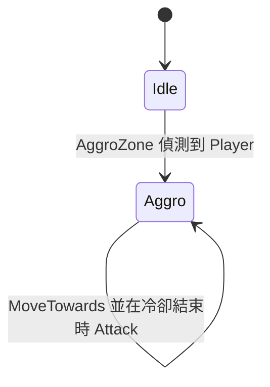
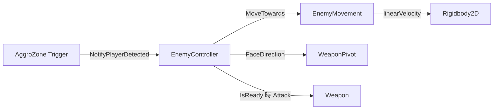
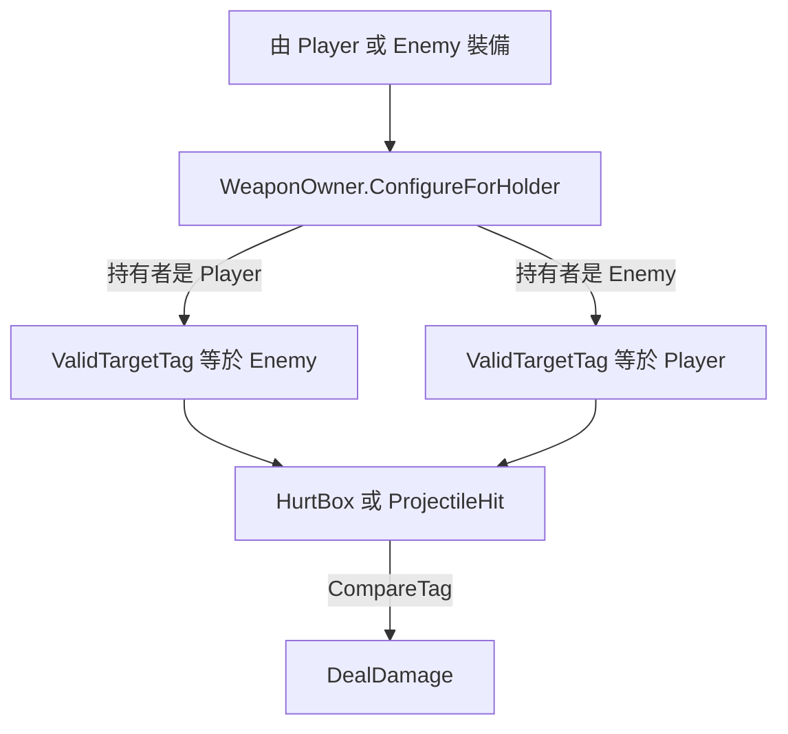
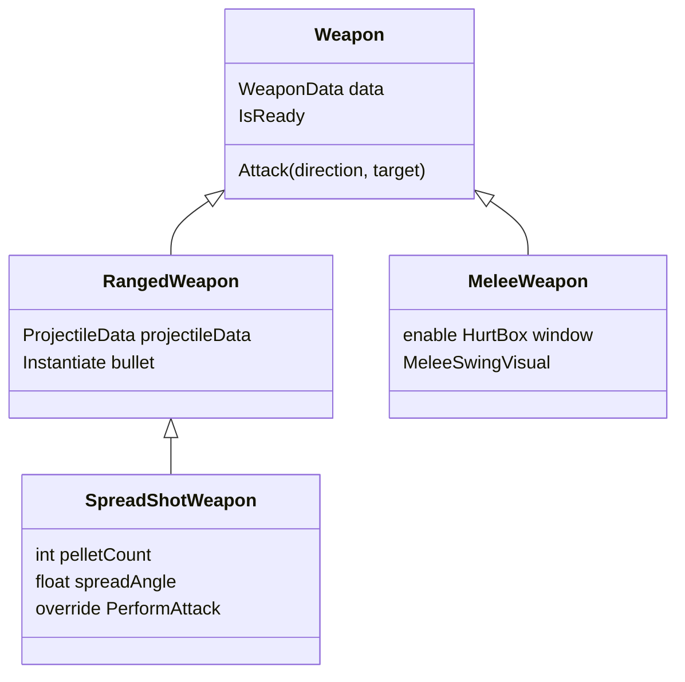
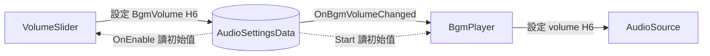

# OOP Lab — Prefab、ScriptableObject 與繼承

## 目標
清場：找到並擊敗場上所有敵人。操作：**WASD** 移動、**按住左鍵**攻擊（受彈藥限制）、**E** 與地上的武器交換、**Esc** 暫停／繼續。

## 專案資料夾結構

```
Assets/
├── Scripts/                  ← 教師提供的遊戲程式碼（本課不需重寫）
│   ├── Player/
│   ├── Enemy/
│   ├── Combat/               ← Health、Weapon、Projectile、Data 類別定義
│   ├── Visuals/
│   ├── Settings/             ← 設定類 ScriptableObject（AudioSettingsData）
│   ├── Audio/                ← BgmPlayer
│   ├── UI/                   ← HUD、選單、VolumeSlider
│   └── Optional/            ← 舊版／進階選修（本實驗不需要）
├── EducationalContent/      ← Prefab 範本與 SO 資產（複製／指派用）
│   ├── Prefabs/
│   └── Data/
├── Docs/
├── Editor/
└── Scenes/
```

## 教師準備（一次）
1. 開 Unity 並等腳本編譯完成。
2. 進入選單：**NTHUGDC → Setup Educational Content**
3. 這會建立 `Assets/EducationalContent/`，包含：
   - `WeaponData_Pistol`、`WeaponData_Axe`、`ProjectileData_Bullet`、`EnemyData_Basic`、`PlayerData_Default`、`AudioSettings_Default`
   - Prefab：`Player`、`EnemyTemplate`、`WeaponTemplate_Ranged`、`WeaponTemplate_Melee`、`Projectile_Bullet`、`UISegment`、`UIs`、`GameMenus`、`BgmPlayer`
4. 將 `Player` 拖到 `BaseScene`。放入幾個 `EnemyTemplate` 與數把地上武器（OnGround）。
5. 把各 Prefab 的 `Sprite` 子物件換成 Kenney 的沙漠射擊素材。
6. Setup 也會把 `GameMenus` + `EventSystem` + `BgmPlayer` 放進 `BaseScene`（暫停／結算 Overlay、背景音樂）。或單獨執行 **NTHUGDC → Setup Game Menus In BaseScene**。
7. 只想補上音量設定時，執行 **NTHUGDC → Setup Audio Settings**。接著在 `EducationalContent/Prefabs/BgmPlayer` 的 **Bgm Clip** 欄位拖入一個音檔（Prefab 預設是空的）。詳見〈用 ScriptableObject 做設定（BGM 音量）〉。

### 產生學生版（`student` 分支）

教師版（`main`）有 `Assets/csc.rsp`（內容 `-define:LAB_SOLUTION`），所以跑的是解答。學生版由 `Tools/make_student.py` 產生：每個 `#if LAB_SOLUTION … #else … #endif` 只留下 `#else` 的 TODO 段，並且不複製 `csc.rsp`。

`student` 是 **orphan 分支**（跟 `main` 沒有共同歷史，不會 merge），每次重新產生就多一個 commit。

**第一次**（建立 orphan 分支，需要 Git 2.42 以上）：

```bash
git worktree add --orphan -b student ../OOPIntro_student
```

> Git 較舊時的等效作法：`git worktree add --detach ../OOPIntro_student`，再到該資料夾執行 `git switch --orphan student`。

**之後每次**（worktree 已存在就跳過上一步）：

```bash
python Tools/make_student.py --out ../OOPIntro_student --dry-run   # 先看會處理哪些檔案、找到幾個洞
python Tools/make_student.py --out ../OOPIntro_student
cd ../OOPIntro_student
git add -A
git commit -m "題目版 v2"
git push -u origin student
```

- `make_student.py` 會先清空輸出資料夾（保留 `.git`），再從**腳本所在的 repo** 複製 `Assets/`、`Packages/`、`ProjectSettings/`、`.gitignore`。需要 Python 3.10 以上。
- 摘要最後一行會列出找到的洞（應為 `LAB-H1`～`LAB-H6`）；若輸出裡還殘留 `LAB_SOLUTION` 或 `#if` 沒配對，腳本會報錯且不算成功。
- 建議 push 前用 Unity 開一次 `../OOPIntro_student`，確認能編譯、遊戲能跑、各洞的功能確實是壞的。
- 課程進行中若要更新題目，盡量只改**洞以外**的檔案，學生 `git pull` 時才不會跟自己寫的 TODO 衝突。

## Prefab 階層規範

### Enemy
```
Enemy
├── UIs             （共用 HUD Prefab：血條 + 彈藥條）
├── Sprite          (+ VelocityWaddleTween)
├── AggroZone       (CircleCollider2D 觸發器)
└── WeaponPivot     (+ WeaponPivot；Aggro 後朝向玩家)
    └── Weapon      (你選的武器 Prefab 實例)
        ├── Sprite
        └── HurtBox
```

### Player
```
Player
├── UIs             （同一個共用 HUD Prefab）
├── Sprite          (+ VelocityWaddleTween)
└── WeaponPivot     (+ WeaponPivot；朝向滑鼠)
    └── Weapon
        ├── Sprite
        └── HurtBox
```

### Weapon
```
Weapon
├── Sprite
└── HurtBox         (近戰：僅在揮砍有效期間開啟；遠程：保持關閉)
```

`WeaponPivot` 負責旋轉；武器在 pivot 底下使用本地 `holdOffset`（偏移量）。

## 戰鬥系統 — 資料流

本節說明**誰呼叫誰**、以及**數值從哪裡來**。本實驗不需要重寫這些腳本，但理解資料流有助於正確放置 Prefab 與 ScriptableObject。

### 整體流程



**怎麼讀這張圖：**
1. 某一方決定攻擊（玩家按左鍵，或敵人 AI）。
2. 都呼叫同一個 API：`Weapon.Attack(direction, target)`。
3. `Weapon` 用 `WeaponData` 檢查**彈藥 + 攻擊間隔**，再呼叫子類別。
4. 子類別要嘛生成子彈，要嘛打開近戰 HurtBox。
5. 傷害最後經 `Damager`（加上**目標 Tag** 過濾）進到 `Health`。

### 數值由誰持有？



| 資料 | 放在哪 | 誰使用 |
|------|--------|--------|
| damage、attackCooldown、maxAmmo、reloadTimePerAmmo | `WeaponData` | 任何 `Weapon` |
| hurtboxActiveDuration | `WeaponData` | 僅 `MeleeWeapon` |
| prefab、speed、lifetime | `ProjectileData` | `RangedWeapon` 元件欄位（不在 WeaponData 上） |
| maxHealth、moveSpeed、aggroRange | `EnemyData` | `EnemyController` → Health／Movement／AggroZone |
| maxHealth、moveSpeed | `PlayerData` | `PlayerController` → Health／PlayerMover |

Sprite 與階層留在 **Prefab**。SO 資產只存**數字與引用**。

### 遠程攻擊時序



敵人走同一條路：`EnemyController` 朝玩家呼叫 `Attack`；`WeaponOwner` 已把 `ValidTargetTag` 設成 `"Player"`，所以敵方子彈會打中玩家。

### 近戰攻擊時序



重要教學點：**動畫 ≠ 命中**。揮砍一定會播；只有啟用中的 HurtBox 碰到合法目標才扣血。

### 敵人警戒與追擊





- `EnemyData.aggroRange` 決定 AggroZone 圓形半徑。
- `EnemyData.moveSpeed` 傳入 `EnemyMovement.MoveTowards`。
- 進入 Aggro 後會持續追擊（本實驗不做 de-aggro）。

### 敵我過濾（`WeaponOwner`）



按 **E** 拾取時，同一個武器 GameObject 會改掛到玩家的 `WeaponPivot` 下，並改成打 `"Enemy"`。丟下後變成 OnGround（不可攻擊），直到再次被撿起。

### 繼承（武器家族）



共用行為（彈藥、攻擊間隔、裝備／丟下、敵我 Tag）在 `Weapon`；不同攻擊方式在子類別——這就是本實驗的 OOP 繼承重點。`SpreadShotWeapon` 再往下繼承一層，改寫 `PerformAttack` 並多次呼叫 `base.PerformAttack`（練習洞 H5）。

### 彈藥與按住連發（Brawl Stars 風格）

近戰與遠程都使用 `WeaponData` 上的同一套彈匣：

| 欄位 | 意義 |
|------|------|
| `maxAmmo` | 彈匣容量（例如 3） |
| `reloadTimePerAmmo` | 未滿時回 **1 發** 所需秒數 |
| `attackCooldown` | 兩次攻擊之間的最短間隔 |

執行時狀態在 `Weapon` 實例上（不寫進 SO）：

- `CurrentAmmo`、`MaxAmmo`、`ReloadProgress01`、`IsAmmoFull`、`DisplayName` — 由玩家 HUD 讀取
- **裝備時從 0 發開始**；之後在裝備中一發一發回彈
- 成功的 `Attack` 消耗 1 發，並**重置**回彈計時
- 裝備中且未滿彈時，`Update` 會一發一發回彈
- **按住左鍵**即可在有彈且間隔允許時連續攻擊
- 敵人也走同一個 `IsReady`：有彈就連打，空彈時繼續追擊並回彈，回出子彈再開火

### 分段血條／彈藥 HUD

共用 Prefab `EducationalContent/Prefabs/UIs`（World-space Canvas，含 `Health` + `Ammo` 兩列 `SegmentedBar`）會掛在 **Player** 與 **EnemyTemplate** 底下：

- 每一格是 `UISegment` 實例（九宮格外框 + 內部 `Image` fill）
- 段數對齊 `Health.MaxValue`／`Weapon.MaxAmmo`，數值改變時會重建（例如換槍）
- 滿格 `fillAmount = 1`，空格為 `0`
- 彈藥的下一空格使用 `ReloadProgress01`，回彈過程會看到 fill 動畫
- 腳本：`Assets/Scripts/UI/` 下的 `SegmentView`、`SegmentedBar`、`HealthBarDisplay`、`AmmoBarDisplay`
- `HealthBarDisplay` 綁定角色身上的 `Health`
- `AmmoBarDisplay` 綁定角色的 `WeaponPivot.CurrentWeapon`（玩家與敵人都適用）
- `Health.OnChanged` 通知血條；彈藥條每幀輪詢當前武器

若缺少 `UIs`／`UISegment` 配線，執行 **NTHUGDC → Setup Educational Content**。

### 暫停／結算 UI

Screen-space Overlay Prefab `EducationalContent/Prefabs/GameMenus`（Setup 會接到 `BaseScene`）：

- **Esc** 切換暫停（`Time.timeScale` 0/1）；Pause 面板即顯即隱
- Pause 面板在標題與 Restart 之間有一列 **BGM 音量 Slider**（+ 百分比文字），由 `VolumeSlider` 寫進 `AudioSettingsData`。`AudioSource` 不受 `timeScale` 影響，暫停時音樂照常播放、Slider 也能拖（見下一節）
- **勝利**：清光敵人（`EnemyRegistry.OnAllEnemiesDefeated`）→ Game Over 淡入「You Win!」
- **失敗**：玩家 `Health.OnKilledEvent` → 同面板「You Lose...」
- 結算淡入用 `CanvasGroup` + `Time.unscaledDeltaTime`，在 `timeScale = 0` 時仍能播
- 兩邊都有 **Restart** 按鈕（`SceneManager.LoadScene` 重載目前場景）
- 左上角 **敵人計數**（`EnemyCountDisplay`）：標籤 + 剩餘 + `/` + 總數（來自 `EnemyRegistry`）
- `GameManager` 除錯旗標（預設關閉）：`skipGameOverPanel`、`skipPauseOnGameOver`
- 需要 **EventSystem** + Input System UI module 才能點按鈕
- Clone 後已含 TextMesh Pro Essential Resources（`Assets/TextMesh Pro/`），選單文字不必再 Import

## 用 ScriptableObject 做設定（BGM 音量）

前面的 `WeaponData`、`EnemyData` 存的是「遊戲數值」；同一招也可以拿來存**遊戲設定**。本專案用 `AudioSettingsData` 存背景音樂音量。

### 為什麼用 SO 存設定？

- **資料集中**：音量只存在一個資產（`AudioSettings_Default`）裡，不散落在各個元件上。要改預設值，改這一個檔案就好。
- **多個元件共用**：`VolumeSlider`（寫入）和 `BgmPlayer`（讀取）拿的是**同一個**資產引用，兩邊不必互相認識，也不用在場景裡互相尋找。
- **Observer（事件通知）**：`AudioSettingsData.BgmVolume` 是屬性，`set` 時會 Clamp 到 0～1，並觸發 `event Action<float> OnBgmVolumeChanged`。誰在意音量，誰就訂閱這個事件；Slider 不需要知道有幾個人在聽。

### 資料流



| 類別 | 檔案 | 重點欄位 |
|------|------|----------|
| `Settings.AudioSettingsData` | `Scripts/Settings/AudioSettingsData.cs` | `bgmVolume`（0～1，預設 0.8）；屬性 `BgmVolume`；事件 `OnBgmVolumeChanged` |
| `Audio.BgmPlayer` | `Scripts/Audio/BgmPlayer.cs` | `Settings`、`Bgm Clip`（拖音檔）、`Play On Start`；OnEnable 訂閱事件、Start 循環播放 |
| `UI.VolumeSlider` | `Scripts/UI/VolumeSlider.cs` | `Settings`、`Slider`、`Value Label`（選填，顯示「80%」）；OnEnable 時 Slider ← SO |

### 老師操作

1. 執行 **NTHUGDC → Setup Audio Settings**（或 **NTHUGDC → Setup Educational Content**，會一起做）。會產生 `EducationalContent/Data/AudioSettings_Default`、`EducationalContent/Prefabs/BgmPlayer`，在暫停畫面加上 BGM 音量 Slider，並把 `BgmPlayer` 放進 `BaseScene`。
2. 打開 `EducationalContent/Prefabs/BgmPlayer`，在 **Bgm Clip** 欄位拖入一個音檔（Prefab 預設是空的；場景裡的實例會跟著 Prefab）。
3. Play → 聽到音樂 → 按 **Esc** 暫停 → 拖動 **BGM 音量** Slider，音量即時改變、百分比跟著變。

### 學生操作

1. 在 Project 視窗按右鍵 **Create → Settings → Audio Settings**，建立第二套設定（例如 `AudioSettings_Quiet`，音量設 0.2）。
2. 把它同時指派到場景中 `BgmPlayer` 與暫停畫面 `VolumeSlider` 的 **Settings** 欄位，Play 比較兩套設定的起始音量。
3. 實驗：**只換其中一個**（例如只換 Slider）會怎樣？——Slider 寫進新設定，BgmPlayer 卻在聽舊設定，所以拖了沒反應。這就是「共用同一個資產」的意義。

### 重點提醒：SO 的數值會留下來

- 在 **Editor** 中 Play 時改 SO（拖 Slider 或直接在 Inspector 改），數值會**直接寫在資產上**，停止 Play **不會還原**。（投影片：「你做的改動都會被儲存喔!!!」）所以 git 會看到 `AudioSettings_Default.asset` 被修改；不想要的話用 git 還原。
- **Build** 出來的遊戲則每次啟動都重置成打包時的數值——SO 不是存檔系統。

> **延伸題**：讓音量在 Build 版也能記住。方向：Unity 的 `PlayerPrefs` 可以存一個 float；想想要在哪個時機讀出來設給 SO（例如遊戲啟動時），又在哪個時機寫回去（例如音量改變時——你已經有一個事件可以訂閱了）。這題不提供程式碼。

## 學生任務

### 取得學生版

學生版放在同一個 repo 的 **`student` 分支**，裡面的關鍵程式被挖掉，換成 `TODO`：

```bash
git clone -b student https://github.com/Oaktheplayer/115A_NTHUGDC_OOPIntro.git
```

或在 GitHub 切到 `student` 分支，按 **Code → Download ZIP**。

- 在 IDE 全專案搜尋 **`TODO [LAB-`** 就能找到所有洞，每個洞的註解都有目標與提示。
- 學生版**可以編譯、遊戲能跑**，只是對應的功能壞掉——先 Play 看看哪裡怪，再去補程式。
- 想對答案：`git checkout main`（`main` 是教師版，含解答；切換前先 commit 自己的進度）。用 ZIP 的同學可以直接在 GitHub 上看 `main` 分支的同一個檔案。

### 練習洞 H1～H6

| ID | 概念 | 檔案／方法 | 一句話目標 |
|----|------|-----------|------------|
| H1 | **上一堂 Physics2D 複習**：Trigger 回呼、Collider2D、Tag | `Enemy/AggroZone.cs` — 自己寫 `OnTriggerEnter2D` | 玩家進入圈圈 → 通知敵人 |
| H2 | ScriptableObject 數值 | `Enemy/EnemyController.cs` — `Awake` | 把 `EnemyData` 套用到血量與仇恨範圍 |
| H3 | Prefab 即時生成 | `Combat/Weapon/RangedWeapon.cs` — `PerformAttack` | 開槍時生成子彈 |
| H4 | 組合（擁有元件） | `Combat/Weapon/HurtBox.cs` — `OnTriggerEnter2D` | 近戰砍到人時扣血 |
| H5 | 繼承、virtual／override | `Combat/Weapon/SpreadShotWeapon.cs` — `PerformAttack` | 散彈槍一次射出扇形多發 |
| H6 | ScriptableObject 設定、Observer | `UI/VolumeSlider.cs`、`Audio/BgmPlayer.cs` | Slider 改音量 |

#### H1 — 敵人發現玩家（上一堂 Physics2D 複習）
- **檔案**：`Assets/Scripts/Enemy/AggroZone.cs`。學生版裡**沒有這個方法**，要自己寫出完整的方法（名稱、參數、內容）。
- **目標**：玩家走進 AggroZone 的圈圈時，確認是玩家，再呼叫 `controller.NotifyPlayerDetected(other.transform)`。
- **提示**：
  - 圈圈的 Collider2D 已設 `isTrigger`，所以要用 **OnTrigger** 系列而不是 OnCollision 系列；方法名稱與參數型別（**2D 版**！）拼錯，Unity 就不會呼叫。
  - 參數是 `Collider2D` 不是 `Collision2D`；用 `CompareTag(Combat.WeaponOwner.PlayerTag)` 判斷。
  - 至少一方要有 Rigidbody2D 才會觸發（敵人身上已經有了）。
- **完成時**：敵人原地不動，玩家一走進圈圈（選取敵人時看到的橘色 Gizmo）就開始追擊、開火。
- **未完成時**：敵人永遠待在原地、不會轉向也不會攻擊——就算你走到它臉上也一樣。

#### H2 — 敵人套用 EnemyData
- **檔案**：`Assets/Scripts/Enemy/EnemyController.cs` 的 `Awake`。
- **目標**：把 `data`（`EnemyData`）裡的 `maxHealth` 與 `aggroRange` 套用到 `health` 與 `aggroZone` 上。
- **提示**：資料集中在 `data`，其他元件再去讀——看看 `Health` 和 `AggroZone` 各有哪個 `public` 方法可以接收這些數值；記得元件可能是 `null`。
- **完成時**：改 `EnemyData` 的 `maxHealth`，敵人的血條格數跟著變；改 `aggroRange`，Play 時發現玩家的距離跟著變。
- **未完成時**：每個敵人的血量都是 `Health` 元件自己的預設值（血條格數跟 `EnemyData` 對不上）；改 `EnemyData` 的數值，Play 時血量與仇恨範圍沒有反應。（`moveSpeed` 不在這個洞裡，所以移動速度仍然正常。）

#### H3 — 開槍生成子彈
- **檔案**：`Assets/Scripts/Combat/Weapon/RangedWeapon.cs` 的 `PerformAttack`。
- **目標**：在 `position` 複製一顆子彈 Prefab，並設定它的傷害與飛行方向。
- **提示**：
  - `Instantiate(projectileData.prefab, ...)`；再用 `GetComponent` 取得 `ProjectileHit`／`ProjectileMover`，呼叫各自的 `Initialize(...)`。
  - 傷害來自 `data.damage`、目標 Tag 來自 `owner.ValidTargetTag`；速度與壽命來自 `projectileData`。
- **完成時**：玩家的手槍與遠程敵人都會射出子彈；子彈打到對方會扣血，不會打到自己人。
- **未完成時**：按左鍵時彈藥條照樣減少，但**沒有子彈**出現；遠程敵人也打不到你。

#### H4 — 近戰 HurtBox 造成傷害
- **檔案**：`Assets/Scripts/Combat/Weapon/HurtBox.cs` 的 `OnTriggerEnter2D`（分成 1/2、2/2 兩處）。
- **目標**：(1) 找出被砍到的物件身上的 `Health` 元件；(2) 把它交給這個 HurtBox 擁有的 `Damager`，讓它造成傷害。
- **提示**：
  - `other.GetComponent<Health>()`；Collider 可能在子物件上，找不到時再試 `GetComponentInParent<Health>()`。
  - `damager` 可能是 `null`，記得檢查；`Damager` 有一個接收 `Health` 的方法。
- **完成時**：斧頭揮到敵人（或近戰敵人揮到你）時扣血；同一次揮砍對同一個目標只扣一次。
- **未完成時**：揮砍動畫照播、彈藥照扣，但**永遠不會扣血**——正好呼應「動畫 ≠ 命中」。

#### H5 — 散彈槍（繼承 RangedWeapon）
- **檔案**：`Assets/Scripts/Combat/Weapon/SpreadShotWeapon.cs` 的 `PerformAttack`（`override`）。
- **目標**：把 `direction` 平均旋轉成 `pelletCount` 個方向（總角度 `spreadAngle`），每個方向各射一發。
- **提示**：
  - 用 `for` 迴圈；`Quaternion.Euler(0f, 0f, 角度) * direction` 可以旋轉方向。
  - 每一發都呼叫 `base.PerformAttack(新方向, target)`，讓父類別幫你生成子彈——所以要**先完成 H3**。
- **注意**：專案裡沒有現成的散彈槍 Prefab，要自己做（見下方〈Prefab 變體練習〉第 2 項）。一次散射只扣 1 發彈藥，這是預期行為（扣彈藥在父類別 `Weapon.Attack`）。
- **完成時**：撿起散彈槍開火，一次射出扇形的 `pelletCount` 顆子彈；在 Inspector 調 `Pellet Count`／`Spread Angle` 會改變散射形狀。
- **未完成時**：學生版的樁只呼叫一次 `base.PerformAttack`，所以散彈槍跟普通手槍一樣只射一顆（H3 也沒做的話則一顆都沒有）。

#### H6 — 音量 Slider（SO 設定＋Observer）
- **檔案**：兩處。
  - `Assets/Scripts/UI/VolumeSlider.cs` 的 `HandleValueChanged`：玩家拖動 Slider 時，把新數值寫進 SO。提示：用**屬性** `settings.BgmVolume`（不是直接改欄位），它會通知所有訂閱者。
  - `Assets/Scripts/Audio/BgmPlayer.cs` 的 `HandleVolumeChanged`：SO 的音量改變時，讓正在播放的 BGM 跟著變。提示：這個方法已在 `OnEnable` 訂閱了 `settings.OnBgmVolumeChanged`，參數 `volume` 就是新音量，把它設給 `audioSource.volume`。
- **完成時**：暫停（Esc）後拖 Slider，音樂音量即時改變；停止 Play 後在 Inspector 看 `AudioSettings_Default`，數值停在你最後拖到的位置（見上一節〈重點提醒〉）。
- **未完成時**：Slider 能拖、百分比文字也會變，但音量完全不變。
  - 只完成 VolumeSlider：SO 的數值有變（Play 中選取資產就看得到），但音樂要等**下一次 Play** 才會用新音量——因為只有 `Start` 讀了一次。
  - 只完成 BgmPlayer：沒人寫 SO，事件不會觸發，所以一樣沒反應。

### Prefab 變體練習

這部分不用寫程式，但會**用到上面的洞**——洞沒補好，做出來的東西就不會動。

#### 1. Enemy Prefab 變體（至少 2 種）——先完成 H1、H2
- 在 `EducationalContent/Prefabs/` 裡複製 `EnemyTemplate`。
- 更換 `Sprite` 子物件外觀。
- 建立新的 **Enemy Data** 資產（`Create → Combat → Enemy Data`），並指派不同：
  `maxHealth`、`moveSpeed`、`aggroRange`。（沒有 H2，`maxHealth`／`aggroRange` 改了也沒用。）
- 把敵人身上的 **Weapon** 子物件換成不同類型（近戰／遠程）——這是敵人設計的一部分。遠程敵人需要 H3、近戰敵人需要 H4 才打得到你。
- 放進場景中測試：敵人未靠近前不動；進入 `AggroZone` 後才會追擊（需要 H1；透過 `EnemyMovement`，使用 Rigidbody2D velocity）。

#### 2. 新的 Weapon Prefab（至少 1 把）——遠程先完成 H3，近戰先完成 H4
- 複製 `WeaponTemplate_Ranged` 或 `WeaponTemplate_Melee`。
- 建立新的 **Weapon Data** 資產（`Create → Combat → Weapon Data`）：
  僅填寫共享數值（damage、cooldown）。SO 裡不要放 Sprite。
- 遠程武器：另外建立 **Projectile Data**，並指派到 **`RangedWeapon` 元件**（不要放在 WeaponData 裡）。
  近戰武器不會用到這個欄位。
- 在武器 Prefab 上調整 `Sprite` / `HurtBox` 尺寸。
- 把武器放到場景（OnGround）。靠近按 **E** 進行拾取／交換（同一實例會變成非功能性的地上狀態）。
- **做散彈槍（H5）**：複製 `WeaponTemplate_Ranged`，在根物件上把 `RangedWeapon` 元件換成 `SpreadShotWeapon`（它是 `RangedWeapon` 的子類別，欄位一樣，再多 `Pellet Count`／`Spread Angle`），重新指派 Weapon Data 與 Projectile Data。

#### 3. （選修）更多繼承練習
- 仿照 H5，繼承 `Weapon` / `RangedWeapon` / `MeleeWeapon` 做出新的攻擊行為（例如連發、穿透），然後把它做成可拾取的 Weapon Prefab。

## ScriptableObjects 會改變什麼
| 資產 | 影響 |
|------|------|
| `WeaponData` | damage、attackCooldown、maxAmmo、reloadTimePerAmmo、近戰 hurtbox 時長 |
| `ProjectileData` | bullet prefab、speed、lifetime（僅由 `RangedWeapon` 參考） |
| `EnemyData` | maxHealth、moveSpeed、aggroRange |
| `PlayerData` | maxHealth、moveSpeed |
| `AudioSettingsData` | bgmVolume（BGM 音量；改值時透過 `OnBgmVolumeChanged` 通知 `BgmPlayer`） |

Sprite 與階層結構放在 Prefab；類別定義在 `Scripts/Combat/Data/`（`AudioSettingsData` 在 `Scripts/Settings/`），資產實例放在 `EducationalContent/Data/`。

## 主要教師提供的程式（在 `Assets/Scripts/`）
| Script | 角色 |
|--------|------|
| `Weapon` / `RangedWeapon` / `MeleeWeapon` | OOP 繼承 + 從 `WeaponData` 讀彈藥／攻擊間隔 |
| `SpreadShotWeapon` | 繼承 `RangedWeapon` 的散彈槍（H5） |
| `WeaponOwner` | 設定要打的目標標籤（Player→Enemy、Enemy→Player）；子彈會繼承設定 |
| `HurtBox` | 近戰在有效幀偵測命中並造成傷害 |
| `EnemyMovement` | 只做 Rigidbody2D velocity 移動（stun／knockback 之後再擴充） |
| `EnemyController` | Idle／Aggro 行為 |
| `VelocityWaddleTween` | 依速度大小做行走小擺動 |
| `MeleeSwingVisual` | 揮砍視覺的旋轉 tween（之後學生再做） |
| `SegmentedBar` / `HealthBarDisplay` / `AmmoBarDisplay` | 分段 World-space 血條與彈藥 HUD |
| `EnemyCountDisplay` | Screen-space 敵人剩餘／總數計數 |
| `GameManager` | 暫停（Esc）、勝負結算 UI、Restart |
| `PlayerController` | 將 `PlayerData` 套用到 Health／PlayerMover |
| `AudioSettingsData` | BGM 音量設定 SO，改值時發出事件 |
| `BgmPlayer` | 循環播放 BGM，訂閱 `AudioSettingsData` 的音量事件 |
| `VolumeSlider` | 暫停畫面的音量 Slider，寫入 `AudioSettingsData` |
| `Player*` | 已完成的玩家 Prefab |

舊版 RangeDetect／舊彈道策略在 `Assets/Scripts/Optional/`，本實驗不需要。

---
English version: [`LAB.md`](LAB.md)

